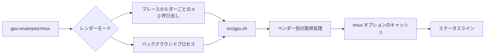

<div align="center">

# tmux-gpu-revamped

<strong>NVIDIA、AMD、Intel、Apple の GPU の負荷、温度、クロック、電力、メモリを tmux のステータスバーに表示します。</strong>

[English](README.md) | 日本語 | [简体中文](README.zh-Hans.md) | [繁體中文（香港）](README.zh-HK.md)

[](https://github.com/tmux-revamped/tmux-gpu-revamped/actions/workflows/tests.yml)
[](LICENSE)
[](CHANGELOG.md)

<p align="center">
  <a href="#できること">できること</a> |
  <a href="#動作要件">動作要件</a> |
  <a href="#インストール">インストール</a> |
  <a href="#使い方">使い方</a> |
  <a href="#設定">設定</a> |
  <a href="#キーバインド">キーバインド</a> |
  <a href="#仕組み">仕組み</a> |
  <a href="#開発">開発</a>
</p>

</div>

**23** 個のステータスプレースホルダーを、Linux の **3** 種類と macOS の **4** 種類の取得元から埋めます。値はすべて tmux オプションにキャッシュされ、一時ファイルは使いません。

---

## できること

`#{gpu_percentage}` や `#{gpu_temp}` などのプレースホルダーを `status-left` または `status-right` に書くと、プラグインがそれぞれを GPU の読み取り値に置き換えます。ホストに取得元がない指標は空で表示され、エラーは出しません。

| プレースホルダー | 出力 |
|:------------|:-------|
| `#{gpu_percentage}` | GPU 負荷。例：`45%` |
| `#{gpu_icon}` | 負荷の段階を示すアイコン |
| `#{gpu_fg_color}`, `#{gpu_bg_color}` | 負荷の段階に対応するスタイル |
| `#{gpu_graph}` | 負荷履歴のスパークライン。例：`▁▃▅█` |
| `#{gpu_temp}` | 整数の度数で表した GPU 温度。例：`60°C` |
| `#{gpu_temp_icon}` | 温度の段階を示すアイコン |
| `#{gpu_temp_fg_color}`, `#{gpu_temp_bg_color}` | 温度の段階に対応するスタイル |
| `#{gpu_freq}` | GPU クロック。例：`1398MHz` |
| `#{gpu_power}` | ワット単位の消費電力。例：`120W` |
| `#{gpu_power_pct}` | 電力上限に対する消費電力の割合 |
| `#{gpu_fan}` | ファン速度の割合 |
| `#{gpu_enc}`, `#{gpu_dec}` | ビデオエンコーダーとデコーダーの使用率 |
| `#{gpu_throttle}` | 有効なスロットル理由：`thermal`、`power`、`hw`、`idle`、`active` |
| `#{gpu_pstate}` | パフォーマンスステート。例：`P0` |
| `#{gpu_top_process}` | GPU メモリを最も多く使っている計算プロセス |
| `#{gram_percentage}` | GPU メモリの使用率。例：`25%` |
| `#{gram_icon}` | メモリの段階を示すアイコン |
| `#{gram_fg_color}`, `#{gram_bg_color}` | メモリの段階に対応するスタイル |
| `#{gram_used}` | 使用量と総量。例：`18G / 24G` |

取得元は表の順に試され、最初に値を返したものが使われます。

| 指標 | Linux | macOS |
|:-------|:------|:------|
| 負荷 | `nvidia-smi`、次に `/sys/class/drm/card*/device/gpu_busy_percent`、次に `rocm-smi` | `ioreg` の IOAccelerator 使用率 |
| 温度 | `nvidia-smi`、次に DRM hwmon の `temp1_input`、次に `rocm-smi` | Apple Silicon では最初に `macmon`、次に `osx-cpu-temp -g`、次に `istats` |
| クロック | `nvidia-smi`、次に `gt_cur_freq_mhz`、次に `rocm-smi --showclocks` | Apple チップまたは Intel Mac の GPU モデルをキーにした表の公称クロックで、実測値ではありません |
| メモリ | `nvidia-smi`、次に `mem_info_vram_used` と `mem_info_vram_total`、次に `rocm-smi` | `ioreg` の使用中システムメモリと RAM 総量の比 |
| 電力 | `nvidia-smi`、次に `rocm-smi` | なし |
| 電力割合、エンコーダー、デコーダー、スロットル、P ステート、トッププロセス | `nvidia-smi` のみ | なし |
| ファン | `nvidia-smi`、次に `rocm-smi` | なし |

`src/gpu.sh doctor` を実行すると、ホストにあるツールとパスが表示されます。

## 動作要件

| 要件 | バージョンまたは補足 |
|:------------|:----------------|
| tmux | `display-popup` のため 3.2 以降 |
| bash | macOS の `/bin/bash` で動くよう 3.2 以降 |
| GPU の取得元、任意 | Linux では `nvidia-smi`、`rocm-smi`、または `/sys/class/drm` のファイル、macOS では `ioreg` |
| macOS の温度、任意 | Apple Silicon では `brew install macmon`、Intel では `brew install osx-cpu-temp`。`istats` も使えます |
| ポップアップのモニター、任意 | `nvtop`、`btop`、またはベンダーの smi と `watch`。`top` がフォールバックです |

CI は Linux の x86_64 と arm64 で GNU coreutils と uutils coreutils を使い、macOS の Apple Silicon と Intel でシステムの BSD ツール、GNU coreutils、uutils coreutils を使ってテストを実行します。

## インストール

[TPM](https://github.com/tmux-plugins/tpm) を使う場合は、`~/.tmux.conf` にプラグインを追加して `prefix + I` を押します。

```tmux
set -g @plugin 'tmux-revamped/tmux-gpu-revamped'
```

TPM を使わない場合は、リポジトリをクローンし、`~/.tmux.conf` からエントリポイントを実行します。

```sh
git clone https://github.com/tmux-revamped/tmux-gpu-revamped ~/.tmux/plugins/tmux-gpu-revamped
```

```tmux
run-shell ~/.tmux/plugins/tmux-gpu-revamped/gpu-revamped.tmux
```

エントリポイントはステータスラインにあるプレースホルダーを書き換えるため、ステータスラインはプラグインの読み込み前に設定してください。

## 使い方

```tmux
set -g @gpu_revamped_low_fg_color '#[fg=green]'
set -g @gpu_revamped_medium_fg_color '#[fg=yellow]'
set -g @gpu_revamped_high_fg_color '#[fg=red]'

set -g status-right '#{gpu_fg_color}#{gpu_icon} #{gpu_percentage}#[default] #{gpu_temp} #{gram_percentage} '
```

これは [`examples/status-right.tmux.conf`](examples/status-right.tmux.conf) の内容です。`prefix + M-g` で詳細ポップアップが開き、`nvtop`、`watch -n 1 rocm-smi`、`watch -n 1 nvidia-smi`、`btop`、`top` のうち最初に見つかったものを実行します。

### ラベルと固定幅

`@gpu_revamped_<metric>_label` は、値が空でないときだけ値の前にアイコンや語を表示します。metric はプレースホルダー名から `gpu_` を除いたもので、`@gpu_revamped_percentage_label` や `@gpu_revamped_gram_used_label` のようになります。`@gpu_revamped_icons` を `nerd` にすると、値を出すすべてのプレースホルダーに Nerd Font のラベルが付きます。指標ごとのラベルはこのセットより優先され、`''` を設定するとその指標のラベルを消せます。既定値の `ascii` はラベルを付けません。

`@gpu_revamped_fixed_width` を `on` にすると、各値を左側から最大幅まで埋めます。割合なら 4 文字なので、`9%` が `42%` になっても右寄せのステータスラインの残りがずれません。`@gpu_revamped_<metric>_width` は 1 つの指標の幅を決め、固定幅より優先されます。長い値が切り詰められることはありません。

### レンダーモード

既定では各プレースホルダーは `#()` 呼び出しになり、tmux はステータスを再描画するたびにそれを実行し直します。`@gpu_revamped_render` を `options` にすると、各プレースホルダーは `#{E:@gpu_revamped_out_gpu_percentage}` のようなオプションの読み取りになります。その場合はサーバーごとに 1 つのバックグラウンドプロセスが `@gpu_revamped_interval` 秒ごとに GPU を計測し、ステータスラインが使う値をすべて 1 回の tmux 呼び出しで書き込み、再描画を 1 回だけ行います。

```tmux
set -g @gpu_revamped_render 'options'
set -g @gpu_revamped_fixed_width 'on'
```

サーバーが停止すると、プロセスは現在の処理を終えてから終了します。設定を再読み込みするとプロセスは置き換わり、既定のモードに戻すと停止します。

## 設定

| オプション | 既定値 | 意味 |
|:-------|:--------|:--------|
| `@gpu_revamped_interval` | `5` | 負荷とメモリの計測値が有効な秒数 |
| `@gpu_revamped_detail_interval` | `60` | 温度、クロック、電力、ファン、エンコーダー、デコーダー、スロットル、P ステート、トッププロセスの値をキャッシュする秒数 |
| `@gpu_revamped_render` | 未設定 | `options` で前述のバックグラウンドプロセスに切り替えます |
| `@gpu_revamped_percentage_format` | `%s%%` | 負荷の書式 |
| `@gpu_revamped_medium_thresh` | `30` | 中段階になる負荷の割合 |
| `@gpu_revamped_high_thresh` | `80` | 高段階になる負荷の割合 |
| `@gpu_revamped_{low,medium,high}_icon` | `▰▱▱`, `▰▰▱`, `▰▰▰` | 負荷の段階アイコン |
| `@gpu_revamped_{low,medium,high}_{fg,bg}_color` | 空 | 負荷の段階スタイル |
| `@gpu_revamped_temp_unit` | `C` | `C` または `F` |
| `@gpu_revamped_temp_format` | `%s°C`、単位が `F` なら `%s°F` | 温度の書式 |
| `@gpu_revamped_temp_medium_thresh` | `65` | 中段階になる温度 |
| `@gpu_revamped_temp_high_thresh` | `80` | 高段階になる温度 |
| `@gpu_revamped_temp_{low,medium,high}_icon` | 空 | 温度の段階アイコン |
| `@gpu_revamped_temp_{low,medium,high}_{fg,bg}_color` | 空 | 温度の段階スタイル |
| `@gpu_revamped_freq_format` | `%sMHz` | クロックの書式 |
| `@gpu_revamped_gram_format` | `%s%%` | メモリ使用率の書式 |
| `@gpu_revamped_gram_medium_thresh` | `50` | 中段階になるメモリ使用率 |
| `@gpu_revamped_gram_high_thresh` | `85` | 高段階になるメモリ使用率 |
| `@gpu_revamped_gram_{low,medium,high}_icon` | `▰▱▱`, `▰▰▱`, `▰▰▰` | メモリの段階アイコン |
| `@gpu_revamped_gram_{low,medium,high}_{fg,bg}_color` | 空 | メモリの段階スタイル |
| `@gpu_revamped_gram_abs_format` | `%s / %s` | `#{gram_used}` の書式 |
| `@gpu_revamped_power_format` | `%sW` | 消費電力の書式 |
| `@gpu_revamped_power_pct_format` | `%s%%` | 電力割合の書式 |
| `@gpu_revamped_fan_format` | `%s%%` | ファン速度の書式 |
| `@gpu_revamped_enc_format`, `@gpu_revamped_dec_format` | `%s%%` | エンコーダーとデコーダー使用率の書式 |
| `@gpu_revamped_throttle_format` | `%s` | スロットル理由の書式 |
| `@gpu_revamped_pstate_format` | `%s` | P ステートの書式 |
| `@gpu_revamped_top_process_format` | `%s` | トッププロセスの書式 |
| `@gpu_revamped_history_size` | `20` | `#{gpu_graph}` に保持する計測数 |
| `@gpu_revamped_icons` | `ascii` | `nerd` ですべての値に Nerd Font のラベルを付けます |
| `@gpu_revamped_<metric>_label` | 未設定 | 1 つの指標の前に表示するラベル |
| `@gpu_revamped_fixed_width` | `off` | `on` ですべての値を最大幅まで埋めます |
| `@gpu_revamped_<metric>_width` | 未設定 | 1 つの指標の幅 |
| `@gpu_revamped_popup_key` | `M-g` | 詳細ポップアップのキー。`off` なら何もバインドしません |
| `@gpu_revamped_popup_command` | 自動 | ポップアップで実行するコマンド |
| `@gpu_revamped_popup_width`, `@gpu_revamped_popup_height` | `80%` | ポップアップの大きさ |

### テーマカラー

段階スタイルは既定で空なので、各指標はステータスライン自身の色のままです。テーマの正確な 16 進値で段階を緑、黄、赤に色分けするには、次のブロックを 1 つコピーします。

<details>
<summary><strong>Catppuccin Mocha</strong></summary>

```tmux
set -g @gpu_revamped_low_fg_color '#[fg=#a6e3a1]'
set -g @gpu_revamped_medium_fg_color '#[fg=#f9e2af]'
set -g @gpu_revamped_high_fg_color '#[fg=#f38ba8]'
set -g @gpu_revamped_temp_low_fg_color '#[fg=#a6e3a1]'
set -g @gpu_revamped_temp_medium_fg_color '#[fg=#f9e2af]'
set -g @gpu_revamped_temp_high_fg_color '#[fg=#f38ba8]'
set -g @gpu_revamped_gram_low_fg_color '#[fg=#a6e3a1]'
set -g @gpu_revamped_gram_medium_fg_color '#[fg=#f9e2af]'
set -g @gpu_revamped_gram_high_fg_color '#[fg=#f38ba8]'
```

</details>

<details>
<summary><strong>Dracula</strong></summary>

```tmux
set -g @gpu_revamped_low_fg_color '#[fg=#50fa7b]'
set -g @gpu_revamped_medium_fg_color '#[fg=#f1fa8c]'
set -g @gpu_revamped_high_fg_color '#[fg=#ff5555]'
set -g @gpu_revamped_temp_low_fg_color '#[fg=#50fa7b]'
set -g @gpu_revamped_temp_medium_fg_color '#[fg=#f1fa8c]'
set -g @gpu_revamped_temp_high_fg_color '#[fg=#ff5555]'
set -g @gpu_revamped_gram_low_fg_color '#[fg=#50fa7b]'
set -g @gpu_revamped_gram_medium_fg_color '#[fg=#f1fa8c]'
set -g @gpu_revamped_gram_high_fg_color '#[fg=#ff5555]'
```

</details>

<details>
<summary><strong>Nord</strong></summary>

```tmux
set -g @gpu_revamped_low_fg_color '#[fg=#a3be8c]'
set -g @gpu_revamped_medium_fg_color '#[fg=#ebcb8b]'
set -g @gpu_revamped_high_fg_color '#[fg=#bf616a]'
set -g @gpu_revamped_temp_low_fg_color '#[fg=#a3be8c]'
set -g @gpu_revamped_temp_medium_fg_color '#[fg=#ebcb8b]'
set -g @gpu_revamped_temp_high_fg_color '#[fg=#bf616a]'
set -g @gpu_revamped_gram_low_fg_color '#[fg=#a3be8c]'
set -g @gpu_revamped_gram_medium_fg_color '#[fg=#ebcb8b]'
set -g @gpu_revamped_gram_high_fg_color '#[fg=#bf616a]'
```

</details>

<details>
<summary><strong>Gruvbox Dark</strong></summary>

```tmux
set -g @gpu_revamped_low_fg_color '#[fg=#b8bb26]'
set -g @gpu_revamped_medium_fg_color '#[fg=#fabd2f]'
set -g @gpu_revamped_high_fg_color '#[fg=#fb4934]'
set -g @gpu_revamped_temp_low_fg_color '#[fg=#b8bb26]'
set -g @gpu_revamped_temp_medium_fg_color '#[fg=#fabd2f]'
set -g @gpu_revamped_temp_high_fg_color '#[fg=#fb4934]'
set -g @gpu_revamped_gram_low_fg_color '#[fg=#b8bb26]'
set -g @gpu_revamped_gram_medium_fg_color '#[fg=#fabd2f]'
set -g @gpu_revamped_gram_high_fg_color '#[fg=#fb4934]'
```

</details>

<details>
<summary><strong>Tokyo Night</strong></summary>

```tmux
set -g @gpu_revamped_low_fg_color '#[fg=#9ece6a]'
set -g @gpu_revamped_medium_fg_color '#[fg=#e0af68]'
set -g @gpu_revamped_high_fg_color '#[fg=#f7768e]'
set -g @gpu_revamped_temp_low_fg_color '#[fg=#9ece6a]'
set -g @gpu_revamped_temp_medium_fg_color '#[fg=#e0af68]'
set -g @gpu_revamped_temp_high_fg_color '#[fg=#f7768e]'
set -g @gpu_revamped_gram_low_fg_color '#[fg=#9ece6a]'
set -g @gpu_revamped_gram_medium_fg_color '#[fg=#e0af68]'
set -g @gpu_revamped_gram_high_fg_color '#[fg=#f7768e]'
```

</details>

<details>
<summary><strong>Solarized Dark</strong></summary>

```tmux
set -g @gpu_revamped_low_fg_color '#[fg=#859900]'
set -g @gpu_revamped_medium_fg_color '#[fg=#b58900]'
set -g @gpu_revamped_high_fg_color '#[fg=#dc322f]'
set -g @gpu_revamped_temp_low_fg_color '#[fg=#859900]'
set -g @gpu_revamped_temp_medium_fg_color '#[fg=#b58900]'
set -g @gpu_revamped_temp_high_fg_color '#[fg=#dc322f]'
set -g @gpu_revamped_gram_low_fg_color '#[fg=#859900]'
set -g @gpu_revamped_gram_medium_fg_color '#[fg=#b58900]'
set -g @gpu_revamped_gram_high_fg_color '#[fg=#dc322f]'
```

</details>

### 内部状態

次のオプションはプラグインが自分で管理します。設定しないでください。

| オプション | 内容 |
|:-------|:------|
| `@gpu_revamped_util_history` | `#{gpu_graph}` が描く直近の負荷計測値。最大 `@gpu_revamped_history_size` 個 |
| `@gpu_revamped_published` | ステータスラインが使う指標を空白区切りで並べたもの。読み込み時に書き込まれ、`options` レンダーモードはこれらだけを公開します |
| `@gpu_revamped_out_<metric>` | `options` レンダーモードで公開される各値。例：`@gpu_revamped_out_gpu_percentage` |
| `@gpu_revamped_ticker_pid` | `options` モードのバックグラウンドプロセスのプロセス ID。これと一致しなくなったプロセスは終了します |
| `@gpu_revamped_<key>`, `@gpu_revamped_<key>_ts` | キャッシュされた読み取り値とその取得時刻。例：`@gpu_revamped_util` |

## キーバインド

| キー | 動作 | 既定 |
|:----|:-------|:--------|
| `prefix + M-g` | 詳細ポップアップ | バインド済み |

`M-g` はファミリーのキー割り当てでこのプラグインに与えられたキーです。バージョン 2.0.0 から既定でバインドされ、以前のバージョンではポップアップは未バインドでした。未バインドのままにするには次のようにします。

```tmux
set -g @gpu_revamped_popup_key 'off'
```

## 仕組み



エントリポイント [`gpu-revamped.tmux`](gpu-revamped.tmux) は、`status-left` と `status-right` の各プレースホルダーを [`src/gpu.sh`](src/gpu.sh) への `#()` 呼び出しに書き換えます。`options` モードではオプションの読み取りに書き換えます。[`src/gpu.sh`](src/gpu.sh) はキャッシュが間隔より古ければ更新し、書式を適用した値を出力します。取得処理は [`src/lib/gpu/gpu.sh`](src/lib/gpu/gpu.sh)、書式は [`src/lib/gpu/render.sh`](src/lib/gpu/render.sh)、スパークラインは [`src/lib/gpu/history.sh`](src/lib/gpu/history.sh)、ポップアップと doctor レポートは [`src/lib/gpu/popup.sh`](src/lib/gpu/popup.sh) にあります。

macOS では更新 1 回につき `ioreg` を 1 回だけ呼び、負荷とメモリの両方に使います。数値の書式は C ロケールで処理されるため、小数点にカンマを使うロケールでも `1.5G` と表示されます。プロセス名に含まれる `#` はステータスラインに届く前にすべて二重化されるため、tmux の書式を注入できません。プラグインのパスはシェル用にクォートされるため、空白や `'` を含むディレクトリでも動きます。

## 開発

| コマンド | 実行内容 |
|:--------|:-------------|
| `make test` | [`test/`](test) 配下の bats テスト |
| `make lint` | すべてのシェルファイルと [`family/bin/`](family/bin) に対する warning 重大度の shellcheck |
| `make coverage` | Linux での kcov による行カバレッジ。95% 未満で失敗します |

[`src/lib/gpu/gpu.sh`](src/lib/gpu/gpu.sh) のパーサーはツールの出力を引数で受け取って数値を返し、ツールの呼び出しはすべて小さな `_read_*` ラッパーに収まっています。そのため、テストは GPU なしで記録済みの出力を渡せます。

## ライセンス

[MIT](LICENSE)、copyright Gustavo Franco。

<!-- family:begin -->

## tmux-revamped ファミリー

このプラグインは tmux-revamped ファミリーの一員です。すべてのメンバーが [`FAMILY.md`](FAMILY.md) の同じ規約、`family/` 配下の同じツール、同じ共有ライブラリを持ち、チェックサムの一覧によってバイト単位で同一に保たれています。メンバーは一緒にインストールする前提で作られており、ほかのメンバーが使うキーや tmux オプションを使うメンバーはありません。

あるメンバーで見つかった不具合は、修正完了とする前に全メンバーで同じ不具合を探します。この義務は記憶に頼らず規約に書かれており、`family/bin/sweep` がその作業を行います。

| メンバー | 機能 |
|---|---|
| [`tmux-autoreload-revamped`](https://github.com/tmux-revamped/tmux-autoreload-revamped) | tmuxの設定を編集して保存するだけで、キーもコマンドも使わずに自動で再読み込みされます |
| [`tmux-battery-revamped`](https://github.com/tmux-revamped/tmux-battery-revamped) | tmuxのステータスバーに電池の状態を表示し、ステータスの描画を一切止めません |
| [`tmux-bluetooth-revamped`](https://github.com/tmux-revamped/tmux-bluetooth-revamped) | 接続中のすべてのBluetooth機器とその電池残量をtmuxのステータスバーに表示し、描画を止めません |
| [`tmux-cpu-revamped`](https://github.com/tmux-revamped/tmux-cpu-revamped) | CPUの負荷、温度、周波数をtmuxのステータスバーに表示し、描画を一切止めません |
| [`tmux-disk-revamped`](https://github.com/tmux-revamped/tmux-disk-revamped) | tmuxのステータスバーにディスク使用量を表示し、ステータスの描画を一切止めません |
| [`tmux-extract-revamped`](https://github.com/tmux-revamped/tmux-extract-revamped) | 画面上の URL、パス、ハッシュなどのトークンを fzf で選び、カーソル位置に入力します。純粋なシェルだけで動きます |
| [`tmux-fzf-revamped`](https://github.com/tmux-revamped/tmux-fzf-revamped) | ポップアップ内の fzf ピッカーから、tmux のセッション、ウィンドウ、ペインの切り替え、終了、名前変更、作成を行います |
| [`tmux-git-revamped`](https://github.com/tmux-revamped/tmux-git-revamped) | アクティブなペインのgitブランチ、変更、プロバイダーの件数を、描画を止めずにtmuxのステータスバーに表示します |
| [`tmux-gpu-revamped`](https://github.com/tmux-revamped/tmux-gpu-revamped) | **このプラグイン**、NVIDIA、AMD、Intel、Apple の GPU の負荷、温度、クロック、電力、メモリを tmux のステータスバーに表示します |
| [`tmux-kube-revamped`](https://github.com/tmux-revamped/tmux-kube-revamped) | 現在の Kubernetes コンテキストと名前空間を、kubectl を使わずに kubeconfig から解析して tmux のステータスバーに表示します |
| [`tmux-launcher-revamped`](https://github.com/tmux-revamped/tmux-launcher-revamped) | 任意の TUI アプリを、現在のペインのディレクトリでポップアップまたはウィンドウとして起動します。アプリごとにキーを設定できます |
| [`tmux-logging-revamped`](https://github.com/tmux-revamped/tmux-logging-revamped) | 任意のペインをファイルに保存します。ライブのログ記録、スクロールバック全体、1 回限りのスクリーンショットに対応します |
| [`tmux-music-revamped`](https://github.com/tmux-revamped/tmux-music-revamped) | 再生中の曲をステータスバーに表示し、ステータスの描画を止めません |
| [`tmux-network-revamped`](https://github.com/tmux-revamped/tmux-network-revamped) | ネットワークのスループットをステータスバーに表示し、描画を止めません |
| [`tmux-pain-control-revamped`](https://github.com/tmux-revamped/tmux-pain-control-revamped) | tmux のペインとウィンドウの操作キー。tmux のバージョンに対応し、vim と共存でき、どの prefix キーも無効にできます |
| [`tmux-persist-revamped`](https://github.com/tmux-revamped/tmux-persist-revamped) | tmuxのすべてのセッション、ウィンドウ、ペインを保存し、タイマーで自動保存して、再起動後にすべて復元します |
| [`tmux-plugin-template`](https://github.com/tmux-revamped/tmux-plugin-template) | tmux-revampedプラグインの出発点です。共有ライブラリ、batsハーネス、CI、ファミリーのツールを含みます |
| [`tmux-pomodoro-revamped`](https://github.com/tmux-revamped/tmux-pomodoro-revamped) | すべての状態をtmuxオプションに保持し、一時ファイルを使わない、tmuxステータスバーのポモドーロタイマーです |
| [`tmux-ram-revamped`](https://github.com/tmux-revamped/tmux-ram-revamped) | RAM、スワップ、メモリプレッシャーをtmuxのステータスバーに表示します。計測はバックグラウンドで行うため描画を待たせません |
| [`tmux-reorder-revamped`](https://github.com/tmux-revamped/tmux-reorder-revamped) | tmuxのステータスバー上でウィンドウのタブをマウスでドラッグして、そのウィンドウを移動します |
| [`tmux-scroll-revamped`](https://github.com/tmux-revamped/tmux-scroll-revamped) | 自分でスクロールできるアプリにはマウスホイールを渡し、それ以外ではtmuxのコピーモードに入ります |
| [`tmux-sensible-revamped`](https://github.com/tmux-revamped/tmux-sensible-revamped) | tmuxのバージョンと端末に合わせて適用され、ユーザーが設定したオプションには触れない、妥当な初期設定です |
| [`tmux-tiling-revamped`](https://github.com/tmux-revamped/tmux-tiling-revamped) | tmuxのタイル型ウィンドウ管理です。BSPのdwindleとspiralを含む8つのレイアウトと、レイアウトの取り消しがあります |
| [`tmux-time-revamped`](https://github.com/tmux-revamped/tmux-time-revamped) | ステータスバーにローカル時計と世界時計を時間帯ごとの色で表示し、カウントダウンと夏時間の警告も出します |
| [`tmux-weather-revamped`](https://github.com/tmux-revamped/tmux-weather-revamped) | wttr.inの天気をバックグラウンドで取得し、ステータスバーを待たせずに表示します |

### インストールの確認

全メンバーがディスク上にあれば、1 つのコマンドでメンバー間の衝突を報告できます。

```sh
family/bin/doctor --live
```

各メンバーと実行中の tmux サーバーを読み取り、重複したキー、重複したステータスのプレースホルダー、命名規則に合わないオプション、規約のバージョンが古いメンバーを報告します。

<!-- family:end -->
