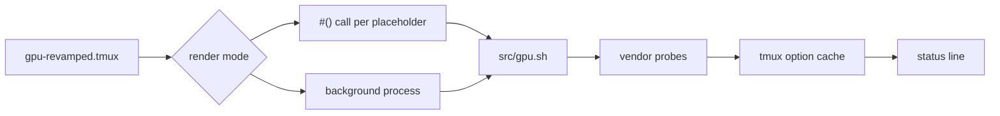

<div align="center">

# tmux-gpu-revamped

<strong>GPU load, temperature, clock, power and memory in the tmux status bar, from NVIDIA, AMD, Intel and Apple GPUs.</strong>

English &nbsp;|&nbsp; [日本語](README.ja.md) &nbsp;|&nbsp; [简体中文](README.zh-Hans.md) &nbsp;|&nbsp; [繁體中文（香港）](README.zh-HK.md)

[](https://github.com/tmux-revamped/tmux-gpu-revamped/actions/workflows/tests.yml)
[](LICENSE)
[](CHANGELOG.md)

<p align="center">
  <a href="#what-it-does">What it does</a> &nbsp;|&nbsp;
  <a href="#requirements">Requirements</a> &nbsp;|&nbsp;
  <a href="#installation">Installation</a> &nbsp;|&nbsp;
  <a href="#usage">Usage</a> &nbsp;|&nbsp;
  <a href="#configuration">Configuration</a> &nbsp;|&nbsp;
  <a href="#key-bindings">Key bindings</a> &nbsp;|&nbsp;
  <a href="#how-it-works">How it works</a> &nbsp;|&nbsp;
  <a href="#development">Development</a>
</p>

</div>

**23** status placeholders fed by **3** Linux sources and **4** macOS sources, with every value cached in tmux options and none in temp files.

---

## What it does

Put placeholders such as `#{gpu_percentage}` or `#{gpu_temp}` in `status-left` or `status-right`, and the plugin replaces each one with a GPU reading. A metric with no source on the host renders empty and never prints an error.

| Placeholder | Output |
|:------------|:-------|
| `#{gpu_percentage}` | GPU load, for example `45%` |
| `#{gpu_icon}` | tier icon for the load |
| `#{gpu_fg_color}`, `#{gpu_bg_color}` | style for the load tier |
| `#{gpu_graph}` | load history sparkline, for example `▁▃▅█` |
| `#{gpu_temp}` | GPU temperature in whole degrees, for example `60°C` |
| `#{gpu_temp_icon}` | tier icon for the temperature |
| `#{gpu_temp_fg_color}`, `#{gpu_temp_bg_color}` | style for the temperature tier |
| `#{gpu_freq}` | GPU clock, for example `1398MHz` |
| `#{gpu_power}` | power draw in watts, for example `120W` |
| `#{gpu_power_pct}` | power draw as a percent of the power limit |
| `#{gpu_fan}` | fan speed percent |
| `#{gpu_enc}`, `#{gpu_dec}` | video encoder and decoder use percent |
| `#{gpu_throttle}` | active throttle reason: `thermal`, `power`, `hw`, `idle` or `active` |
| `#{gpu_pstate}` | performance state, for example `P0` |
| `#{gpu_top_process}` | the compute process using the most GPU memory |
| `#{gram_percentage}` | GPU memory used, for example `25%` |
| `#{gram_icon}` | tier icon for memory |
| `#{gram_fg_color}`, `#{gram_bg_color}` | style for the memory tier |
| `#{gram_used}` | used and total memory, for example `18G / 24G` |

Each source is tried in the order listed, and the first one that returns a value wins:

| Metric | Linux | macOS |
|:-------|:------|:------|
| Load | `nvidia-smi`, then `/sys/class/drm/card*/device/gpu_busy_percent`, then `rocm-smi` | `ioreg` IOAccelerator utilization |
| Temperature | `nvidia-smi`, then the DRM hwmon `temp1_input`, then `rocm-smi` | on Apple Silicon `macmon` first, then `osx-cpu-temp -g`, then `istats` |
| Clock | `nvidia-smi`, then `gt_cur_freq_mhz`, then `rocm-smi --showclocks` | nominal clock from a table keyed on the Apple chip or the Intel Mac GPU model, not a live reading |
| Memory | `nvidia-smi`, then `mem_info_vram_used` and `mem_info_vram_total`, then `rocm-smi` | `ioreg` in-use system memory against total RAM |
| Power | `nvidia-smi`, then `rocm-smi` | none |
| Power percent, encoder, decoder, throttle, P-state, top process | `nvidia-smi` only | none |
| Fan | `nvidia-smi`, then `rocm-smi` | none |

`src/gpu.sh doctor` prints which of these tools and paths the host has.

## Requirements

| Requirement | Version or note |
|:------------|:----------------|
| tmux | 3.2 or later, for `display-popup` |
| bash | 3.2 or later, so the macOS `/bin/bash` works |
| A GPU source, optional | `nvidia-smi`, `rocm-smi` or the `/sys/class/drm` files on Linux, `ioreg` on macOS |
| macOS temperature, optional | `brew install macmon` on Apple Silicon, `brew install osx-cpu-temp` on Intel; `istats` also works |
| Popup monitor, optional | `nvtop`, `btop`, or `watch` with a vendor smi; `top` is the fallback |

CI runs the suite on Linux x86_64 and arm64 with GNU and uutils coreutils, and on macOS Apple Silicon and Intel with the system BSD tools, GNU coreutils and uutils coreutils.

## Installation

With [TPM](https://github.com/tmux-plugins/tpm), add the plugin to `~/.tmux.conf` and press `prefix + I`:

```tmux
set -g @plugin 'tmux-revamped/tmux-gpu-revamped'
```

Without TPM, clone the repository and run the entrypoint from `~/.tmux.conf`:

```sh
git clone https://github.com/tmux-revamped/tmux-gpu-revamped ~/.tmux/plugins/tmux-gpu-revamped
```

```tmux
run-shell ~/.tmux/plugins/tmux-gpu-revamped/gpu-revamped.tmux
```

Set the status line before the plugin loads, because the entrypoint rewrites the placeholders it finds there.

## Usage

```tmux
set -g @gpu_revamped_low_fg_color '#[fg=green]'
set -g @gpu_revamped_medium_fg_color '#[fg=yellow]'
set -g @gpu_revamped_high_fg_color '#[fg=red]'

set -g status-right '#{gpu_fg_color}#{gpu_icon} #{gpu_percentage}#[default] #{gpu_temp} #{gram_percentage} '
```

This is [`examples/status-right.tmux.conf`](examples/status-right.tmux.conf). `prefix + M-g` opens a detail popup running `nvtop`, `watch -n 1 rocm-smi`, `watch -n 1 nvidia-smi`, `btop` or `top`, the first one installed.

### Labels and fixed width

`@gpu_revamped_<metric>_label` prints an icon or word before a value, only when the value is not empty. The metric is the placeholder name without its `gpu_` prefix, such as `@gpu_revamped_percentage_label` or `@gpu_revamped_gram_used_label`. `@gpu_revamped_icons` set to `nerd` labels every value placeholder from a Nerd Font set. A metric's own label wins over the set, and `''` removes the set's label for that metric. The default, `ascii`, adds no labels.

`@gpu_revamped_fixed_width` set to `on` pads each value on the left to its widest form, four characters for a percentage, so `9%` becoming `42%` does not shift the rest of a right-aligned status line. `@gpu_revamped_<metric>_width` sets one metric's width and wins over the fixed width. A longer value is never cut.

### Render mode

By default each placeholder becomes a `#()` call, which tmux reruns on every status redraw. With `@gpu_revamped_render` set to `options`, each placeholder becomes a read of an option such as `#{E:@gpu_revamped_out_gpu_percentage}`. One background process per server then samples the GPU every `@gpu_revamped_interval` seconds, writes every value the status line uses in one tmux call, and redraws once.

```tmux
set -g @gpu_revamped_render 'options'
set -g @gpu_revamped_fixed_width 'on'
```

The process exits after its current tick when the server stops. A config reload replaces it, and switching back to the default mode stops it.

## Configuration

| Option | Default | Meaning |
|:-------|:--------|:--------|
| `@gpu_revamped_interval` | `5` | seconds a load and memory sample stays fresh |
| `@gpu_revamped_detail_interval` | `60` | seconds the temperature, clock, power, fan, encoder, decoder, throttle, P-state and top process readings stay cached |
| `@gpu_revamped_render` | unset | `options` switches to the background process described above |
| `@gpu_revamped_percentage_format` | `%s%%` | format for the load |
| `@gpu_revamped_medium_thresh` | `30` | load percent for the medium tier |
| `@gpu_revamped_high_thresh` | `80` | load percent for the high tier |
| `@gpu_revamped_{low,medium,high}_icon` | `▰▱▱`, `▰▰▱`, `▰▰▰` | load tier icons |
| `@gpu_revamped_{low,medium,high}_{fg,bg}_color` | empty | load tier styles |
| `@gpu_revamped_temp_unit` | `C` | `C` or `F` |
| `@gpu_revamped_temp_format` | `%s°C`, or `%s°F` with unit `F` | format for the temperature |
| `@gpu_revamped_temp_medium_thresh` | `65` | degrees for the medium tier |
| `@gpu_revamped_temp_high_thresh` | `80` | degrees for the high tier |
| `@gpu_revamped_temp_{low,medium,high}_icon` | empty | temperature tier icons |
| `@gpu_revamped_temp_{low,medium,high}_{fg,bg}_color` | empty | temperature tier styles |
| `@gpu_revamped_freq_format` | `%sMHz` | format for the clock |
| `@gpu_revamped_gram_format` | `%s%%` | format for memory percent |
| `@gpu_revamped_gram_medium_thresh` | `50` | memory percent for the medium tier |
| `@gpu_revamped_gram_high_thresh` | `85` | memory percent for the high tier |
| `@gpu_revamped_gram_{low,medium,high}_icon` | `▰▱▱`, `▰▰▱`, `▰▰▰` | memory tier icons |
| `@gpu_revamped_gram_{low,medium,high}_{fg,bg}_color` | empty | memory tier styles |
| `@gpu_revamped_gram_abs_format` | `%s / %s` | format for `#{gram_used}` |
| `@gpu_revamped_power_format` | `%sW` | format for the power draw |
| `@gpu_revamped_power_pct_format` | `%s%%` | format for the power percent |
| `@gpu_revamped_fan_format` | `%s%%` | format for the fan speed |
| `@gpu_revamped_enc_format`, `@gpu_revamped_dec_format` | `%s%%` | format for encoder and decoder use |
| `@gpu_revamped_throttle_format` | `%s` | format for the throttle reason |
| `@gpu_revamped_pstate_format` | `%s` | format for the P-state |
| `@gpu_revamped_top_process_format` | `%s` | format for the top process |
| `@gpu_revamped_history_size` | `20` | samples kept for `#{gpu_graph}` |
| `@gpu_revamped_icons` | `ascii` | `nerd` labels every value from a Nerd Font set |
| `@gpu_revamped_<metric>_label` | unset | label printed before one metric |
| `@gpu_revamped_fixed_width` | `off` | `on` pads every value to its widest form |
| `@gpu_revamped_<metric>_width` | unset | width for one metric |
| `@gpu_revamped_popup_key` | `M-g` | key for the detail popup; `off` binds nothing |
| `@gpu_revamped_popup_command` | auto | command run in the popup |
| `@gpu_revamped_popup_width`, `@gpu_revamped_popup_height` | `80%` | popup size |

### Theme colors

The tier styles are empty by default, so each metric keeps the status line's own colors. Copy one block to color the tiers green, yellow and red with a theme's exact hex values.

<details>
<summary><strong>Catppuccin Mocha</strong></summary>

```tmux
set -g @gpu_revamped_low_fg_color '#[fg=#a6e3a1]'
set -g @gpu_revamped_medium_fg_color '#[fg=#f9e2af]'
set -g @gpu_revamped_high_fg_color '#[fg=#f38ba8]'
set -g @gpu_revamped_temp_low_fg_color '#[fg=#a6e3a1]'
set -g @gpu_revamped_temp_medium_fg_color '#[fg=#f9e2af]'
set -g @gpu_revamped_temp_high_fg_color '#[fg=#f38ba8]'
set -g @gpu_revamped_gram_low_fg_color '#[fg=#a6e3a1]'
set -g @gpu_revamped_gram_medium_fg_color '#[fg=#f9e2af]'
set -g @gpu_revamped_gram_high_fg_color '#[fg=#f38ba8]'
```

</details>

<details>
<summary><strong>Dracula</strong></summary>

```tmux
set -g @gpu_revamped_low_fg_color '#[fg=#50fa7b]'
set -g @gpu_revamped_medium_fg_color '#[fg=#f1fa8c]'
set -g @gpu_revamped_high_fg_color '#[fg=#ff5555]'
set -g @gpu_revamped_temp_low_fg_color '#[fg=#50fa7b]'
set -g @gpu_revamped_temp_medium_fg_color '#[fg=#f1fa8c]'
set -g @gpu_revamped_temp_high_fg_color '#[fg=#ff5555]'
set -g @gpu_revamped_gram_low_fg_color '#[fg=#50fa7b]'
set -g @gpu_revamped_gram_medium_fg_color '#[fg=#f1fa8c]'
set -g @gpu_revamped_gram_high_fg_color '#[fg=#ff5555]'
```

</details>

<details>
<summary><strong>Nord</strong></summary>

```tmux
set -g @gpu_revamped_low_fg_color '#[fg=#a3be8c]'
set -g @gpu_revamped_medium_fg_color '#[fg=#ebcb8b]'
set -g @gpu_revamped_high_fg_color '#[fg=#bf616a]'
set -g @gpu_revamped_temp_low_fg_color '#[fg=#a3be8c]'
set -g @gpu_revamped_temp_medium_fg_color '#[fg=#ebcb8b]'
set -g @gpu_revamped_temp_high_fg_color '#[fg=#bf616a]'
set -g @gpu_revamped_gram_low_fg_color '#[fg=#a3be8c]'
set -g @gpu_revamped_gram_medium_fg_color '#[fg=#ebcb8b]'
set -g @gpu_revamped_gram_high_fg_color '#[fg=#bf616a]'
```

</details>

<details>
<summary><strong>Gruvbox Dark</strong></summary>

```tmux
set -g @gpu_revamped_low_fg_color '#[fg=#b8bb26]'
set -g @gpu_revamped_medium_fg_color '#[fg=#fabd2f]'
set -g @gpu_revamped_high_fg_color '#[fg=#fb4934]'
set -g @gpu_revamped_temp_low_fg_color '#[fg=#b8bb26]'
set -g @gpu_revamped_temp_medium_fg_color '#[fg=#fabd2f]'
set -g @gpu_revamped_temp_high_fg_color '#[fg=#fb4934]'
set -g @gpu_revamped_gram_low_fg_color '#[fg=#b8bb26]'
set -g @gpu_revamped_gram_medium_fg_color '#[fg=#fabd2f]'
set -g @gpu_revamped_gram_high_fg_color '#[fg=#fb4934]'
```

</details>

<details>
<summary><strong>Tokyo Night</strong></summary>

```tmux
set -g @gpu_revamped_low_fg_color '#[fg=#9ece6a]'
set -g @gpu_revamped_medium_fg_color '#[fg=#e0af68]'
set -g @gpu_revamped_high_fg_color '#[fg=#f7768e]'
set -g @gpu_revamped_temp_low_fg_color '#[fg=#9ece6a]'
set -g @gpu_revamped_temp_medium_fg_color '#[fg=#e0af68]'
set -g @gpu_revamped_temp_high_fg_color '#[fg=#f7768e]'
set -g @gpu_revamped_gram_low_fg_color '#[fg=#9ece6a]'
set -g @gpu_revamped_gram_medium_fg_color '#[fg=#e0af68]'
set -g @gpu_revamped_gram_high_fg_color '#[fg=#f7768e]'
```

</details>

<details>
<summary><strong>Solarized Dark</strong></summary>

```tmux
set -g @gpu_revamped_low_fg_color '#[fg=#859900]'
set -g @gpu_revamped_medium_fg_color '#[fg=#b58900]'
set -g @gpu_revamped_high_fg_color '#[fg=#dc322f]'
set -g @gpu_revamped_temp_low_fg_color '#[fg=#859900]'
set -g @gpu_revamped_temp_medium_fg_color '#[fg=#b58900]'
set -g @gpu_revamped_temp_high_fg_color '#[fg=#dc322f]'
set -g @gpu_revamped_gram_low_fg_color '#[fg=#859900]'
set -g @gpu_revamped_gram_medium_fg_color '#[fg=#b58900]'
set -g @gpu_revamped_gram_high_fg_color '#[fg=#dc322f]'
```

</details>

### Internal state

The plugin manages these options itself. Do not set them.

| Option | Holds |
|:-------|:------|
| `@gpu_revamped_util_history` | the recent load samples, at most `@gpu_revamped_history_size`, that `#{gpu_graph}` draws |
| `@gpu_revamped_published` | space-separated metrics the status line uses, written at load so the `options` render mode publishes only those |
| `@gpu_revamped_out_<metric>` | each published value in the `options` render mode, such as `@gpu_revamped_out_gpu_percentage` |
| `@gpu_revamped_ticker_pid` | the process id of the `options` mode background process; a process that no longer matches it exits |
| `@gpu_revamped_<key>`, `@gpu_revamped_<key>_ts` | cached readings and the time each was taken, such as `@gpu_revamped_util` |

## Key bindings

| Key | Action | Default |
|:----|:-------|:--------|
| `prefix + M-g` | detail popup | bound |

`M-g` is this plugin's slot in the family key allocation. Version 2.0.0 binds it by default, where earlier versions left the popup unbound. To keep it unbound:

```tmux
set -g @gpu_revamped_popup_key 'off'
```

## How it works



The entrypoint [`gpu-revamped.tmux`](gpu-revamped.tmux) rewrites each placeholder in `status-left` and `status-right` into a `#()` call to [`src/gpu.sh`](src/gpu.sh), or into an option read in the `options` mode. [`src/gpu.sh`](src/gpu.sh) refreshes the cache when it is older than the interval and prints the formatted value. The probes live in [`src/lib/gpu/gpu.sh`](src/lib/gpu/gpu.sh), the formatting in [`src/lib/gpu/render.sh`](src/lib/gpu/render.sh), the sparkline in [`src/lib/gpu/history.sh`](src/lib/gpu/history.sh), and the popup and doctor report in [`src/lib/gpu/popup.sh`](src/lib/gpu/popup.sh).

On macOS one `ioreg` call per refresh serves both load and memory. Number formatting runs under the C locale, so a comma-decimal locale still prints `1.5G`. A process name containing `#` has every `#` doubled before it reaches the status line, so it cannot inject a tmux format. The plugin path is shell-quoted, so a directory with a space or a `'` works.

## Development

| Command | What it runs |
|:--------|:-------------|
| `make test` | the bats suite under [`test/`](test) |
| `make lint` | shellcheck at warning severity on every shell file and [`family/bin/`](family/bin) |
| `make coverage` | kcov line coverage on Linux, failing below 95% |

The parsers in [`src/lib/gpu/gpu.sh`](src/lib/gpu/gpu.sh) take tool output as an argument and return a number, and every tool call sits in a small `_read_*` wrapper, so the tests feed recorded output without a GPU.

## License

[MIT](LICENSE), copyright Gustavo Franco.

<!-- family:begin -->

## The tmux-revamped family

This plugin is one member of the tmux-revamped family. Every member carries the
same contract in [`FAMILY.md`](FAMILY.md), the same tooling under `family/`, and
the same shared library, all held byte-identical by a checksum manifest. They are
built to be installed together: no member claims a key or a tmux option that
another member claims.

A defect found in one member is hunted across all of them before the fix is
called done. That obligation is written into the contract rather than left to
memory, and `family/bin/sweep` is how it is discharged.

| Member | What it does |
|---|---|
| [`tmux-autoreload-revamped`](https://github.com/tmux-revamped/tmux-autoreload-revamped) | Edit your tmux config, save, and watch it reload itself, no key, no command |
| [`tmux-battery-revamped`](https://github.com/tmux-revamped/tmux-battery-revamped) | Battery status for your tmux status bar, without ever blocking the status render |
| [`tmux-bluetooth-revamped`](https://github.com/tmux-revamped/tmux-bluetooth-revamped) | Every connected Bluetooth device and its battery in your tmux status bar, without blocking the render |
| [`tmux-cpu-revamped`](https://github.com/tmux-revamped/tmux-cpu-revamped) | CPU load, temperature, and frequency in your tmux status bar, without ever blocking the render |
| [`tmux-disk-revamped`](https://github.com/tmux-revamped/tmux-disk-revamped) | Disk usage for your tmux status bar, without ever blocking the status render |
| [`tmux-extract-revamped`](https://github.com/tmux-revamped/tmux-extract-revamped) | Pick a URL, path, hash or any other token off the screen with fzf and type it at the cursor, in pure shell |
| [`tmux-fzf-revamped`](https://github.com/tmux-revamped/tmux-fzf-revamped) | Switch to, kill, rename or create tmux sessions, windows and panes from fzf pickers in a popup |
| [`tmux-git-revamped`](https://github.com/tmux-revamped/tmux-git-revamped) | Show the active pane's git branch, changes and provider counts in the tmux status bar without blocking it |
| [`tmux-gpu-revamped`](https://github.com/tmux-revamped/tmux-gpu-revamped) | **this plugin**, GPU load, temperature, clock, power and memory in the tmux status bar, from NVIDIA, AMD, Intel and Apple GPUs |
| [`tmux-kube-revamped`](https://github.com/tmux-revamped/tmux-kube-revamped) | Current Kubernetes context and namespace in the tmux status bar, parsed from kubeconfig without kubectl |
| [`tmux-launcher-revamped`](https://github.com/tmux-revamped/tmux-launcher-revamped) | Launch any TUI app in a popup or a window, scoped to the current pane's directory, with one configurable bindi |
| [`tmux-logging-revamped`](https://github.com/tmux-revamped/tmux-logging-revamped) | Capture any pane to a file: live logging, full scrollback, or a one-shot screenshot |
| [`tmux-music-revamped`](https://github.com/tmux-revamped/tmux-music-revamped) | Now playing in your tmux status bar, without ever blocking the status render |
| [`tmux-network-revamped`](https://github.com/tmux-revamped/tmux-network-revamped) | Network throughput in your tmux status bar, without ever blocking the render |
| [`tmux-pain-control-revamped`](https://github.com/tmux-revamped/tmux-pain-control-revamped) | Standard pane and window management bindings for tmux, version aware, vim friendly, and fully configurable |
| [`tmux-persist-revamped`](https://github.com/tmux-revamped/tmux-persist-revamped) | Save every tmux session, window and pane, auto-save on a timer, and restore it all after a reboot |
| [`tmux-plugin-template`](https://github.com/tmux-revamped/tmux-plugin-template) | A template for building non-blocking tmux status plugins |
| [`tmux-pomodoro-revamped`](https://github.com/tmux-revamped/tmux-pomodoro-revamped) | A Pomodoro timer in the tmux status bar that keeps all of its state in tmux options, with no temp files |
| [`tmux-ram-revamped`](https://github.com/tmux-revamped/tmux-ram-revamped) | RAM, swap and memory pressure in the tmux status bar, sampled in the background so the render never waits |
| [`tmux-reorder-revamped`](https://github.com/tmux-revamped/tmux-reorder-revamped) | Drag a window tab along the tmux status bar with the mouse to move that window |
| [`tmux-scroll-revamped`](https://github.com/tmux-revamped/tmux-scroll-revamped) | Send the mouse wheel to apps that scroll themselves and into tmux copy-mode everywhere else |
| [`tmux-sensible-revamped`](https://github.com/tmux-revamped/tmux-sensible-revamped) | Sensible tmux defaults, gated by tmux version and terminal, that leave the options you set alone |
| [`tmux-tiling-revamped`](https://github.com/tmux-revamped/tmux-tiling-revamped) | BSP tiling window management for tmux. Eight layouts, nineteen operations, zero dependencies |
| [`tmux-time-revamped`](https://github.com/tmux-revamped/tmux-time-revamped) | Local and world clocks for the tmux status bar, colored by time of day, with countdowns and a DST warning |
| [`tmux-weather-revamped`](https://github.com/tmux-revamped/tmux-weather-revamped) | Weather for the tmux status bar from wttr.in, fetched in the background so the status line never waits |

### Checking an installation

With every member on disk, one command reports any conflict between them:

```sh
family/bin/doctor --live
```

It reads each member and the running tmux server, and reports duplicate keys,
duplicate status placeholders, options outside the naming grammar, and any
member whose contract version has fallen behind.

<!-- family:end -->
