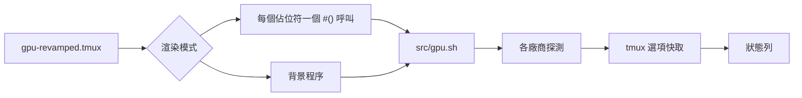

<div align="center">

# tmux-gpu-revamped

<strong>在 tmux 狀態列顯示 NVIDIA、AMD、Intel 及 Apple GPU 的負載、溫度、時脈、功耗及記憶體。</strong>

[English](README.md) | [日本語](README.ja.md) | [简体中文](README.zh-Hans.md) | 繁體中文（香港）

[](https://github.com/tmux-revamped/tmux-gpu-revamped/actions/workflows/tests.yml)
[](LICENSE)
[](CHANGELOG.md)

<p align="center">
  <a href="#功能">功能</a> |
  <a href="#系統要求">系統要求</a> |
  <a href="#安裝">安裝</a> |
  <a href="#用法">用法</a> |
  <a href="#設定">設定</a> |
  <a href="#按鍵綁定">按鍵綁定</a> |
  <a href="#運作原理">運作原理</a> |
  <a href="#開發">開發</a>
</p>

</div>

**23** 個狀態佔位符，資料來自 **3** 種 Linux 來源及 **4** 種 macOS 來源，所有數值都快取在 tmux 選項中，不寫入暫存檔案。

---

## 功能

在 `status-left` 或 `status-right` 中寫入 `#{gpu_percentage}`、`#{gpu_temp}` 等佔位符，外掛程式會把每個佔位符換成 GPU 讀數。主機上沒有來源的指標會顯示為空白，不會輸出錯誤。

| 佔位符 | 輸出 |
|:------------|:-------|
| `#{gpu_percentage}` | GPU 負載，例如 `45%` |
| `#{gpu_icon}` | 負載級別圖示 |
| `#{gpu_fg_color}`, `#{gpu_bg_color}` | 負載級別對應的樣式 |
| `#{gpu_graph}` | 負載歷史迷你圖，例如 `▁▃▅█` |
| `#{gpu_temp}` | 以整數度數表示的 GPU 溫度，例如 `60°C` |
| `#{gpu_temp_icon}` | 溫度級別圖示 |
| `#{gpu_temp_fg_color}`, `#{gpu_temp_bg_color}` | 溫度級別對應的樣式 |
| `#{gpu_freq}` | GPU 時脈，例如 `1398MHz` |
| `#{gpu_power}` | 以瓦為單位的功耗，例如 `120W` |
| `#{gpu_power_pct}` | 功耗佔功率上限的百分比 |
| `#{gpu_fan}` | 風扇轉速百分比 |
| `#{gpu_enc}`, `#{gpu_dec}` | 視訊編碼器及解碼器使用率 |
| `#{gpu_throttle}` | 目前的降頻原因：`thermal`、`power`、`hw`、`idle` 或 `active` |
| `#{gpu_pstate}` | 效能狀態，例如 `P0` |
| `#{gpu_top_process}` | 佔用最多 GPU 記憶體的運算程序 |
| `#{gram_percentage}` | GPU 記憶體使用率，例如 `25%` |
| `#{gram_icon}` | 記憶體級別圖示 |
| `#{gram_fg_color}`, `#{gram_bg_color}` | 記憶體級別對應的樣式 |
| `#{gram_used}` | 已用量及總量，例如 `18G / 24G` |

各來源按表中次序嘗試，第一個傳回數值的來源生效：

| 指標 | Linux | macOS |
|:-------|:------|:------|
| 負載 | `nvidia-smi`，然後 `/sys/class/drm/card*/device/gpu_busy_percent`，然後 `rocm-smi` | `ioreg` 的 IOAccelerator 使用率 |
| 溫度 | `nvidia-smi`，然後 DRM hwmon 的 `temp1_input`，然後 `rocm-smi` | Apple Silicon 上先用 `macmon`，然後 `osx-cpu-temp -g`，然後 `istats` |
| 時脈 | `nvidia-smi`，然後 `gt_cur_freq_mhz`，然後 `rocm-smi --showclocks` | 按 Apple 晶片或 Intel Mac GPU 型號查表所得的標稱時脈，並非即時讀數 |
| 記憶體 | `nvidia-smi`，然後 `mem_info_vram_used` 及 `mem_info_vram_total`，然後 `rocm-smi` | `ioreg` 的已用系統記憶體與記憶體總量之比 |
| 功耗 | `nvidia-smi`，然後 `rocm-smi` | 無 |
| 功耗百分比、編碼器、解碼器、降頻、P 狀態、佔用最多的程序 | 只限 `nvidia-smi` | 無 |
| 風扇 | `nvidia-smi`，然後 `rocm-smi` | 無 |

執行 `src/gpu.sh doctor` 可查看主機上有哪些工具及路徑。

## 系統要求

| 要求 | 版本或說明 |
|:------------|:----------------|
| tmux | 3.2 或以上，因為需要 `display-popup` |
| bash | 3.2 或以上，因此 macOS 的 `/bin/bash` 可以執行 |
| GPU 來源，可選 | Linux 上為 `nvidia-smi`、`rocm-smi` 或 `/sys/class/drm` 檔案，macOS 上為 `ioreg` |
| macOS 溫度，可選 | Apple Silicon 上 `brew install macmon`，Intel 上 `brew install osx-cpu-temp`；`istats` 亦可 |
| 彈出視窗監察程式，可選 | `nvtop`、`btop`，或 `watch` 配合廠商 smi；`top` 為後備 |

CI 在 Linux x86_64 及 arm64 上使用 GNU coreutils 及 uutils coreutils 執行測試，在 macOS Apple Silicon 及 Intel 上使用系統內建的 BSD 工具、GNU coreutils 及 uutils coreutils 執行測試。

## 安裝

使用 [TPM](https://github.com/tmux-plugins/tpm) 時，把外掛程式加入 `~/.tmux.conf`，然後按 `prefix + I`：

```tmux
set -g @plugin 'tmux-revamped/tmux-gpu-revamped'
```

不使用 TPM 時，複製儲存庫，並在 `~/.tmux.conf` 中執行進入點腳本：

```sh
git clone https://github.com/tmux-revamped/tmux-gpu-revamped ~/.tmux/plugins/tmux-gpu-revamped
```

```tmux
run-shell ~/.tmux/plugins/tmux-gpu-revamped/gpu-revamped.tmux
```

進入點腳本會改寫狀態列中找到的佔位符，因此要在外掛程式載入前設定狀態列。

## 用法

```tmux
set -g @gpu_revamped_low_fg_color '#[fg=green]'
set -g @gpu_revamped_medium_fg_color '#[fg=yellow]'
set -g @gpu_revamped_high_fg_color '#[fg=red]'

set -g status-right '#{gpu_fg_color}#{gpu_icon} #{gpu_percentage}#[default] #{gpu_temp} #{gram_percentage} '
```

這就是 [`examples/status-right.tmux.conf`](examples/status-right.tmux.conf) 的內容。`prefix + M-g` 開啟詳情彈出視窗，執行 `nvtop`、`watch -n 1 rocm-smi`、`watch -n 1 nvidia-smi`、`btop` 或 `top` 中第一個已安裝的程式。

### 標籤及固定寬度

`@gpu_revamped_<metric>_label` 只在數值不為空時，於數值前顯示一個圖示或字詞。metric 是去掉 `gpu_` 前綴的佔位符名稱，例如 `@gpu_revamped_percentage_label` 或 `@gpu_revamped_gram_used_label`。把 `@gpu_revamped_icons` 設為 `nerd`，所有輸出數值的佔位符都會加上一組 Nerd Font 標籤。個別指標自己的標籤優先於這組標籤，設為 `''` 可移除該指標的標籤。預設值 `ascii` 不加標籤。

把 `@gpu_revamped_fixed_width` 設為 `on`，每個數值會在左邊補齊至最大寬度，百分比為 4 個字元，因此 `9%` 變成 `42%` 時，靠右對齊的狀態列其餘部分不會移位。`@gpu_revamped_<metric>_width` 設定個別指標的寬度，優先於固定寬度。較長的數值不會被截斷。

### 渲染模式

預設情況下每個佔位符會變成一個 `#()` 呼叫，tmux 每次重繪狀態列都會重新執行。把 `@gpu_revamped_render` 設為 `options` 後，每個佔位符會變成讀取選項，例如 `#{E:@gpu_revamped_out_gpu_percentage}`。此時每個伺服器只有一個背景程序，每隔 `@gpu_revamped_interval` 秒取樣一次 GPU，以一次 tmux 呼叫寫入狀態列用到的所有數值，並只重繪一次。

```tmux
set -g @gpu_revamped_render 'options'
set -g @gpu_revamped_fixed_width 'on'
```

伺服器停止後，該程序完成目前一輪便會結束。重新載入設定會取代該程序，切回預設模式會將其停止。

## 設定

| 選項 | 預設值 | 意思 |
|:-------|:--------|:--------|
| `@gpu_revamped_interval` | `5` | 負載及記憶體取樣保持有效的秒數 |
| `@gpu_revamped_detail_interval` | `60` | 溫度、時脈、功耗、風扇、編碼器、解碼器、降頻、P 狀態及佔用最多的程序的讀數快取秒數 |
| `@gpu_revamped_render` | 未設定 | `options` 切換至上文所述的背景程序 |
| `@gpu_revamped_percentage_format` | `%s%%` | 負載的格式 |
| `@gpu_revamped_medium_thresh` | `30` | 進入中級別的負載百分比 |
| `@gpu_revamped_high_thresh` | `80` | 進入高級別的負載百分比 |
| `@gpu_revamped_{low,medium,high}_icon` | `▰▱▱`, `▰▰▱`, `▰▰▰` | 負載級別圖示 |
| `@gpu_revamped_{low,medium,high}_{fg,bg}_color` | 空白 | 負載級別樣式 |
| `@gpu_revamped_temp_unit` | `C` | `C` 或 `F` |
| `@gpu_revamped_temp_format` | `%s°C`，單位為 `F` 時為 `%s°F` | 溫度的格式 |
| `@gpu_revamped_temp_medium_thresh` | `65` | 進入中級別的溫度 |
| `@gpu_revamped_temp_high_thresh` | `80` | 進入高級別的溫度 |
| `@gpu_revamped_temp_{low,medium,high}_icon` | 空白 | 溫度級別圖示 |
| `@gpu_revamped_temp_{low,medium,high}_{fg,bg}_color` | 空白 | 溫度級別樣式 |
| `@gpu_revamped_freq_format` | `%sMHz` | 時脈的格式 |
| `@gpu_revamped_gram_format` | `%s%%` | 記憶體百分比的格式 |
| `@gpu_revamped_gram_medium_thresh` | `50` | 進入中級別的記憶體百分比 |
| `@gpu_revamped_gram_high_thresh` | `85` | 進入高級別的記憶體百分比 |
| `@gpu_revamped_gram_{low,medium,high}_icon` | `▰▱▱`, `▰▰▱`, `▰▰▰` | 記憶體級別圖示 |
| `@gpu_revamped_gram_{low,medium,high}_{fg,bg}_color` | 空白 | 記憶體級別樣式 |
| `@gpu_revamped_gram_abs_format` | `%s / %s` | `#{gram_used}` 的格式 |
| `@gpu_revamped_power_format` | `%sW` | 功耗的格式 |
| `@gpu_revamped_power_pct_format` | `%s%%` | 功耗百分比的格式 |
| `@gpu_revamped_fan_format` | `%s%%` | 風扇轉速的格式 |
| `@gpu_revamped_enc_format`, `@gpu_revamped_dec_format` | `%s%%` | 編碼器及解碼器使用率的格式 |
| `@gpu_revamped_throttle_format` | `%s` | 降頻原因的格式 |
| `@gpu_revamped_pstate_format` | `%s` | P 狀態的格式 |
| `@gpu_revamped_top_process_format` | `%s` | 佔用最多的程序的格式 |
| `@gpu_revamped_history_size` | `20` | `#{gpu_graph}` 保留的取樣數目 |
| `@gpu_revamped_icons` | `ascii` | `nerd` 為所有數值加上 Nerd Font 標籤 |
| `@gpu_revamped_<metric>_label` | 未設定 | 顯示在個別指標前的標籤 |
| `@gpu_revamped_fixed_width` | `off` | `on` 把所有數值補齊至最大寬度 |
| `@gpu_revamped_<metric>_width` | 未設定 | 個別指標的寬度 |
| `@gpu_revamped_popup_key` | `M-g` | 詳情彈出視窗的按鍵；`off` 表示不綁定 |
| `@gpu_revamped_popup_command` | 自動 | 彈出視窗中執行的指令 |
| `@gpu_revamped_popup_width`, `@gpu_revamped_popup_height` | `80%` | 彈出視窗大小 |

### 主題配色

級別樣式預設為空白，因此每個指標保持狀態列本身的顏色。如要以某個主題的精確十六進制顏色把級別標示為綠、黃、紅，複製以下任何一段即可。

<details>
<summary><strong>Catppuccin Mocha</strong></summary>

```tmux
set -g @gpu_revamped_low_fg_color '#[fg=#a6e3a1]'
set -g @gpu_revamped_medium_fg_color '#[fg=#f9e2af]'
set -g @gpu_revamped_high_fg_color '#[fg=#f38ba8]'
set -g @gpu_revamped_temp_low_fg_color '#[fg=#a6e3a1]'
set -g @gpu_revamped_temp_medium_fg_color '#[fg=#f9e2af]'
set -g @gpu_revamped_temp_high_fg_color '#[fg=#f38ba8]'
set -g @gpu_revamped_gram_low_fg_color '#[fg=#a6e3a1]'
set -g @gpu_revamped_gram_medium_fg_color '#[fg=#f9e2af]'
set -g @gpu_revamped_gram_high_fg_color '#[fg=#f38ba8]'
```

</details>

<details>
<summary><strong>Dracula</strong></summary>

```tmux
set -g @gpu_revamped_low_fg_color '#[fg=#50fa7b]'
set -g @gpu_revamped_medium_fg_color '#[fg=#f1fa8c]'
set -g @gpu_revamped_high_fg_color '#[fg=#ff5555]'
set -g @gpu_revamped_temp_low_fg_color '#[fg=#50fa7b]'
set -g @gpu_revamped_temp_medium_fg_color '#[fg=#f1fa8c]'
set -g @gpu_revamped_temp_high_fg_color '#[fg=#ff5555]'
set -g @gpu_revamped_gram_low_fg_color '#[fg=#50fa7b]'
set -g @gpu_revamped_gram_medium_fg_color '#[fg=#f1fa8c]'
set -g @gpu_revamped_gram_high_fg_color '#[fg=#ff5555]'
```

</details>

<details>
<summary><strong>Nord</strong></summary>

```tmux
set -g @gpu_revamped_low_fg_color '#[fg=#a3be8c]'
set -g @gpu_revamped_medium_fg_color '#[fg=#ebcb8b]'
set -g @gpu_revamped_high_fg_color '#[fg=#bf616a]'
set -g @gpu_revamped_temp_low_fg_color '#[fg=#a3be8c]'
set -g @gpu_revamped_temp_medium_fg_color '#[fg=#ebcb8b]'
set -g @gpu_revamped_temp_high_fg_color '#[fg=#bf616a]'
set -g @gpu_revamped_gram_low_fg_color '#[fg=#a3be8c]'
set -g @gpu_revamped_gram_medium_fg_color '#[fg=#ebcb8b]'
set -g @gpu_revamped_gram_high_fg_color '#[fg=#bf616a]'
```

</details>

<details>
<summary><strong>Gruvbox Dark</strong></summary>

```tmux
set -g @gpu_revamped_low_fg_color '#[fg=#b8bb26]'
set -g @gpu_revamped_medium_fg_color '#[fg=#fabd2f]'
set -g @gpu_revamped_high_fg_color '#[fg=#fb4934]'
set -g @gpu_revamped_temp_low_fg_color '#[fg=#b8bb26]'
set -g @gpu_revamped_temp_medium_fg_color '#[fg=#fabd2f]'
set -g @gpu_revamped_temp_high_fg_color '#[fg=#fb4934]'
set -g @gpu_revamped_gram_low_fg_color '#[fg=#b8bb26]'
set -g @gpu_revamped_gram_medium_fg_color '#[fg=#fabd2f]'
set -g @gpu_revamped_gram_high_fg_color '#[fg=#fb4934]'
```

</details>

<details>
<summary><strong>Tokyo Night</strong></summary>

```tmux
set -g @gpu_revamped_low_fg_color '#[fg=#9ece6a]'
set -g @gpu_revamped_medium_fg_color '#[fg=#e0af68]'
set -g @gpu_revamped_high_fg_color '#[fg=#f7768e]'
set -g @gpu_revamped_temp_low_fg_color '#[fg=#9ece6a]'
set -g @gpu_revamped_temp_medium_fg_color '#[fg=#e0af68]'
set -g @gpu_revamped_temp_high_fg_color '#[fg=#f7768e]'
set -g @gpu_revamped_gram_low_fg_color '#[fg=#9ece6a]'
set -g @gpu_revamped_gram_medium_fg_color '#[fg=#e0af68]'
set -g @gpu_revamped_gram_high_fg_color '#[fg=#f7768e]'
```

</details>

<details>
<summary><strong>Solarized Dark</strong></summary>

```tmux
set -g @gpu_revamped_low_fg_color '#[fg=#859900]'
set -g @gpu_revamped_medium_fg_color '#[fg=#b58900]'
set -g @gpu_revamped_high_fg_color '#[fg=#dc322f]'
set -g @gpu_revamped_temp_low_fg_color '#[fg=#859900]'
set -g @gpu_revamped_temp_medium_fg_color '#[fg=#b58900]'
set -g @gpu_revamped_temp_high_fg_color '#[fg=#dc322f]'
set -g @gpu_revamped_gram_low_fg_color '#[fg=#859900]'
set -g @gpu_revamped_gram_medium_fg_color '#[fg=#b58900]'
set -g @gpu_revamped_gram_high_fg_color '#[fg=#dc322f]'
```

</details>

### 內部狀態

以下選項由外掛程式自行管理，請勿設定。

| 選項 | 內容 |
|:-------|:------|
| `@gpu_revamped_util_history` | `#{gpu_graph}` 繪製的最近負載取樣，最多 `@gpu_revamped_history_size` 個 |
| `@gpu_revamped_published` | 狀態列用到的指標，以空格分隔，於載入時寫入，`options` 渲染模式只發佈這些指標 |
| `@gpu_revamped_out_<metric>` | `options` 渲染模式下發佈的各個數值，例如 `@gpu_revamped_out_gpu_percentage` |
| `@gpu_revamped_ticker_pid` | `options` 模式背景程序的程序 ID；不再與之相符的程序會結束 |
| `@gpu_revamped_<key>`, `@gpu_revamped_<key>_ts` | 快取的讀數及其取樣時間，例如 `@gpu_revamped_util` |

## 按鍵綁定

| 按鍵 | 動作 | 預設 |
|:----|:-------|:--------|
| `prefix + M-g` | 詳情彈出視窗 | 已綁定 |

`M-g` 是家族按鍵分配中分給本外掛程式的按鍵。2.0.0 版起預設綁定，之前的版本不綁定彈出視窗。如要保持不綁定：

```tmux
set -g @gpu_revamped_popup_key 'off'
```

## 運作原理



進入點腳本 [`gpu-revamped.tmux`](gpu-revamped.tmux) 把 `status-left` 及 `status-right` 中的每個佔位符改寫為對 [`src/gpu.sh`](src/gpu.sh) 的 `#()` 呼叫，在 `options` 模式下則改寫為讀取選項。[`src/gpu.sh`](src/gpu.sh) 在快取超過間隔時更新快取，並輸出格式化後的數值。探測程式碼在 [`src/lib/gpu/gpu.sh`](src/lib/gpu/gpu.sh)，格式化在 [`src/lib/gpu/render.sh`](src/lib/gpu/render.sh)，迷你圖在 [`src/lib/gpu/history.sh`](src/lib/gpu/history.sh)，彈出視窗及 doctor 報告在 [`src/lib/gpu/popup.sh`](src/lib/gpu/popup.sh)。

在 macOS 上每次更新只呼叫一次 `ioreg`，負載及記憶體共用其輸出。數字格式化在 C locale 下進行，因此以逗號作小數點的 locale 仍會顯示 `1.5G`。程序名稱中的每個 `#` 在到達狀態列前都會被雙寫，因此無法注入 tmux 格式。外掛程式路徑經過 shell 引號處理，所以包含空格或 `'` 的目錄亦能正常運作。

## 開發

| 指令 | 執行內容 |
|:--------|:-------------|
| `make test` | [`test/`](test) 下的 bats 測試 |
| `make lint` | 對所有 shell 檔案及 [`family/bin/`](family/bin) 執行 warning 級別的 shellcheck |
| `make coverage` | 在 Linux 上以 kcov 統計行覆蓋率，低於 95% 時失敗 |

[`src/lib/gpu/gpu.sh`](src/lib/gpu/gpu.sh) 中的解析函數以參數接收工具輸出並傳回數字，每次工具呼叫都放在一個小型 `_read_*` 包裝函數中，因此測試無需 GPU 即可傳入預先錄製的輸出。

## 授權

[MIT](LICENSE)，copyright Gustavo Franco。

<!-- family:begin -->

## tmux-revamped 插件家族

本插件是 tmux-revamped 插件家族的成員。每個成員都帶有 [`FAMILY.md`](FAMILY.md) 中的同一份約定、`family/` 下的同一套工具和同一個共用程式庫，並由校驗和清單確保逐位元組一致。這些成員可以一併安裝：任何成員都不會佔用其他成員使用的按鍵或 tmux 選項。

在一個成員中發現的缺陷，要在全部成員中排查後才算修正完成。這項責任寫在約定之中，而不是依靠記憶，`family/bin/sweep` 負責執行。

| 成員 | 功能 |
|---|---|
| [`tmux-autoreload-revamped`](https://github.com/tmux-revamped/tmux-autoreload-revamped) | 編輯並儲存 tmux 設定後，它會自動重新載入，毋須按鍵，也毋須指令 |
| [`tmux-battery-revamped`](https://github.com/tmux-revamped/tmux-battery-revamped) | 在 tmux 狀態列顯示電池狀態，從不阻塞狀態列繪製 |
| [`tmux-bluetooth-revamped`](https://github.com/tmux-revamped/tmux-bluetooth-revamped) | 在 tmux 狀態列顯示每部已連接的藍牙裝置及其電量，不阻塞繪製 |
| [`tmux-cpu-revamped`](https://github.com/tmux-revamped/tmux-cpu-revamped) | 在 tmux 狀態列顯示 CPU 負載、溫度及頻率，從不阻塞繪製 |
| [`tmux-disk-revamped`](https://github.com/tmux-revamped/tmux-disk-revamped) | 在 tmux 狀態列顯示磁碟用量，從不阻塞狀態列繪製 |
| [`tmux-extract-revamped`](https://github.com/tmux-revamped/tmux-extract-revamped) | 用 fzf 從畫面上揀選 URL、路徑、雜湊值或任何其他字詞，並輸入到游標位置，全部以純 shell 實現 |
| [`tmux-fzf-revamped`](https://github.com/tmux-revamped/tmux-fzf-revamped) | 在彈出視窗的 fzf 選擇器中切換、關閉、重新命名或建立 tmux 工作階段、視窗和窗格 |
| [`tmux-git-revamped`](https://github.com/tmux-revamped/tmux-git-revamped) | 在 tmux 狀態列顯示當前窗格的 git 分支、改動和託管平台數目，而不會阻塞顯示 |
| [`tmux-gpu-revamped`](https://github.com/tmux-revamped/tmux-gpu-revamped) | **本插件**，在 tmux 狀態列顯示 NVIDIA、AMD、Intel 及 Apple GPU 的負載、溫度、時脈、功耗及記憶體 |
| [`tmux-kube-revamped`](https://github.com/tmux-revamped/tmux-kube-revamped) | 在 tmux 狀態列顯示目前的 Kubernetes 上下文及命名空間，毋須 kubectl，直接解析 kubeconfig |
| [`tmux-launcher-revamped`](https://github.com/tmux-revamped/tmux-launcher-revamped) | 在彈出視窗或新視窗中啟動任何 TUI 應用程式，從目前窗格的目錄開始，每個應用程式可設定一個按鍵 |
| [`tmux-logging-revamped`](https://github.com/tmux-revamped/tmux-logging-revamped) | 將任何窗格儲存到檔案：即時記錄、完整捲動緩衝區或一次性截圖 |
| [`tmux-music-revamped`](https://github.com/tmux-revamped/tmux-music-revamped) | 在 tmux 狀態列顯示正在播放的歌曲，從不阻塞狀態列的繪製 |
| [`tmux-network-revamped`](https://github.com/tmux-revamped/tmux-network-revamped) | 在 tmux 狀態列顯示網絡傳輸量，從不阻塞繪製 |
| [`tmux-pain-control-revamped`](https://github.com/tmux-revamped/tmux-pain-control-revamped) | tmux 的窗格和視窗管理按鍵，配合 tmux 版本，與 vim 相容，每個 prefix 按鍵都可停用 |
| [`tmux-persist-revamped`](https://github.com/tmux-revamped/tmux-persist-revamped) | 儲存 tmux 的所有工作階段、視窗及窗格，按計時器自動儲存，並在重新開機後全部還原 |
| [`tmux-plugin-template`](https://github.com/tmux-revamped/tmux-plugin-template) | tmux-revamped 插件的起點：共用程式庫、bats 測試框架、CI 和系列工具 |
| [`tmux-pomodoro-revamped`](https://github.com/tmux-revamped/tmux-pomodoro-revamped) | tmux 狀態列中的番茄鐘計時器，所有狀態都儲存在 tmux 選項中，不使用暫存檔 |
| [`tmux-ram-revamped`](https://github.com/tmux-revamped/tmux-ram-revamped) | 在 tmux 狀態列顯示記憶體、交換空間及記憶體壓力，在背景取樣，繪製從不等待 |
| [`tmux-reorder-revamped`](https://github.com/tmux-revamped/tmux-reorder-revamped) | 用滑鼠在 tmux 狀態列上拖動視窗標籤來移動該視窗 |
| [`tmux-scroll-revamped`](https://github.com/tmux-revamped/tmux-scroll-revamped) | 將滑鼠滾輪交給能自行捲動的應用程式，其他情況下進入 tmux 複製模式 |
| [`tmux-sensible-revamped`](https://github.com/tmux-revamped/tmux-sensible-revamped) | 按 tmux 版本和終端機區分的合理預設設定，不會改動你自己設定的選項 |
| [`tmux-tiling-revamped`](https://github.com/tmux-revamped/tmux-tiling-revamped) | tmux 的平鋪視窗管理：八種版面，包括 BSP dwindle 和 spiral，並支援復原版面 |
| [`tmux-time-revamped`](https://github.com/tmux-revamped/tmux-time-revamped) | 狀態列中的本地時鐘和世界時鐘，按一天中的時段著色，並提供倒數和夏令時間提示 |
| [`tmux-weather-revamped`](https://github.com/tmux-revamped/tmux-weather-revamped) | 在背景從 wttr.in 取得天氣並顯示在狀態列，狀態列毋須等待 |

### 檢查安裝

所有成員都在磁碟上時，一個指令即可報告它們之間的任何衝突：

```sh
family/bin/doctor --live
```

它讀取每個成員和正在運行的 tmux 伺服器，報告重複的按鍵、重複的狀態佔位符、不符合命名規則的選項，以及約定版本落後的成員。

<!-- family:end -->
