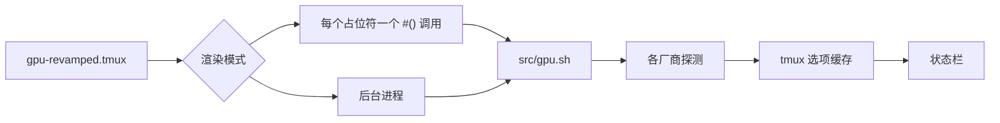

<div align="center">

# tmux-gpu-revamped

<strong>在 tmux 状态栏中显示 NVIDIA、AMD、Intel 和 Apple GPU 的负载、温度、频率、功耗和显存。</strong>

[English](README.md) &nbsp;|&nbsp; [日本語](README.ja.md) &nbsp;|&nbsp; 简体中文 &nbsp;|&nbsp; [繁體中文（香港）](README.zh-HK.md)

[](https://github.com/tmux-revamped/tmux-gpu-revamped/actions/workflows/tests.yml)
[](LICENSE)
[](CHANGELOG.md)

<p align="center">
  <a href="#功能">功能</a> &nbsp;|&nbsp;
  <a href="#环境要求">环境要求</a> &nbsp;|&nbsp;
  <a href="#安装">安装</a> &nbsp;|&nbsp;
  <a href="#用法">用法</a> &nbsp;|&nbsp;
  <a href="#配置">配置</a> &nbsp;|&nbsp;
  <a href="#按键绑定">按键绑定</a> &nbsp;|&nbsp;
  <a href="#工作原理">工作原理</a> &nbsp;|&nbsp;
  <a href="#开发">开发</a>
</p>

</div>

**23** 个状态占位符，数据来自 **3** 种 Linux 来源和 **4** 种 macOS 来源，所有值都缓存在 tmux 选项中，不写临时文件。

---

## 功能

在 `status-left` 或 `status-right` 中写入 `#{gpu_percentage}`、`#{gpu_temp}` 等占位符，插件会把每个占位符替换为 GPU 读数。主机上没有来源的指标显示为空，不会输出错误。

| 占位符 | 输出 |
|:------------|:-------|
| `#{gpu_percentage}` | GPU 负载，例如 `45%` |
| `#{gpu_icon}` | 负载等级图标 |
| `#{gpu_fg_color}`, `#{gpu_bg_color}` | 负载等级对应的样式 |
| `#{gpu_graph}` | 负载历史迷你图，例如 `▁▃▅█` |
| `#{gpu_temp}` | 以整数度数表示的 GPU 温度，例如 `60°C` |
| `#{gpu_temp_icon}` | 温度等级图标 |
| `#{gpu_temp_fg_color}`, `#{gpu_temp_bg_color}` | 温度等级对应的样式 |
| `#{gpu_freq}` | GPU 频率，例如 `1398MHz` |
| `#{gpu_power}` | 以瓦为单位的功耗，例如 `120W` |
| `#{gpu_power_pct}` | 功耗占功率上限的百分比 |
| `#{gpu_fan}` | 风扇转速百分比 |
| `#{gpu_enc}`, `#{gpu_dec}` | 视频编码器和解码器使用率 |
| `#{gpu_throttle}` | 当前的降频原因：`thermal`、`power`、`hw`、`idle` 或 `active` |
| `#{gpu_pstate}` | 性能状态，例如 `P0` |
| `#{gpu_top_process}` | 占用 GPU 显存最多的计算进程 |
| `#{gram_percentage}` | GPU 显存使用率，例如 `25%` |
| `#{gram_icon}` | 显存等级图标 |
| `#{gram_fg_color}`, `#{gram_bg_color}` | 显存等级对应的样式 |
| `#{gram_used}` | 已用量和总量，例如 `18G / 24G` |

各来源按表中顺序尝试，第一个返回值的来源生效：

| 指标 | Linux | macOS |
|:-------|:------|:------|
| 负载 | `nvidia-smi`，然后 `/sys/class/drm/card*/device/gpu_busy_percent`，然后 `rocm-smi` | `ioreg` 的 IOAccelerator 使用率 |
| 温度 | `nvidia-smi`，然后 DRM hwmon 的 `temp1_input`，然后 `rocm-smi` | Apple Silicon 上先用 `macmon`，然后 `osx-cpu-temp -g`，然后 `istats` |
| 频率 | `nvidia-smi`，然后 `gt_cur_freq_mhz`，然后 `rocm-smi --showclocks` | 按 Apple 芯片或 Intel Mac GPU 型号查表得到的标称频率，不是实时读数 |
| 显存 | `nvidia-smi`，然后 `mem_info_vram_used` 和 `mem_info_vram_total`，然后 `rocm-smi` | `ioreg` 的已用系统内存与内存总量之比 |
| 功耗 | `nvidia-smi`，然后 `rocm-smi` | 无 |
| 功耗百分比、编码器、解码器、降频、P 状态、占用最多的进程 | 仅 `nvidia-smi` | 无 |
| 风扇 | `nvidia-smi`，然后 `rocm-smi` | 无 |

运行 `src/gpu.sh doctor` 可以查看主机上有哪些工具和路径。

## 环境要求

| 要求 | 版本或说明 |
|:------------|:----------------|
| tmux | 3.2 或更高版本，因为需要 `display-popup` |
| bash | 3.2 或更高版本，因此 macOS 的 `/bin/bash` 可以运行 |
| GPU 来源，可选 | Linux 上为 `nvidia-smi`、`rocm-smi` 或 `/sys/class/drm` 文件，macOS 上为 `ioreg` |
| macOS 温度，可选 | Apple Silicon 上 `brew install macmon`，Intel 上 `brew install osx-cpu-temp`；`istats` 也可以 |
| 弹窗监视器，可选 | `nvtop`、`btop`，或 `watch` 配合厂商 smi；`top` 为后备 |

CI 在 Linux x86_64 和 arm64 上使用 GNU coreutils 与 uutils coreutils 运行测试，在 macOS Apple Silicon 和 Intel 上使用系统自带的 BSD 工具、GNU coreutils 与 uutils coreutils 运行测试。

## 安装

使用 [TPM](https://github.com/tmux-plugins/tpm) 时，把插件加入 `~/.tmux.conf`，然后按 `prefix + I`：

```tmux
set -g @plugin 'tmux-revamped/tmux-gpu-revamped'
```

不使用 TPM 时，克隆仓库，并在 `~/.tmux.conf` 中运行入口脚本：

```sh
git clone https://github.com/tmux-revamped/tmux-gpu-revamped ~/.tmux/plugins/tmux-gpu-revamped
```

```tmux
run-shell ~/.tmux/plugins/tmux-gpu-revamped/gpu-revamped.tmux
```

入口脚本会改写状态栏中找到的占位符，因此要在插件加载之前设置状态栏。

## 用法

```tmux
set -g @gpu_revamped_low_fg_color '#[fg=green]'
set -g @gpu_revamped_medium_fg_color '#[fg=yellow]'
set -g @gpu_revamped_high_fg_color '#[fg=red]'

set -g status-right '#{gpu_fg_color}#{gpu_icon} #{gpu_percentage}#[default] #{gpu_temp} #{gram_percentage} '
```

这就是 [`examples/status-right.tmux.conf`](examples/status-right.tmux.conf) 的内容。`prefix + M-g` 打开详情弹窗，运行 `nvtop`、`watch -n 1 rocm-smi`、`watch -n 1 nvidia-smi`、`btop` 或 `top` 中第一个已安装的程序。

### 标签与固定宽度

`@gpu_revamped_<metric>_label` 只在值不为空时，在值前面显示一个图标或词语。metric 是去掉 `gpu_` 前缀的占位符名，例如 `@gpu_revamped_percentage_label` 或 `@gpu_revamped_gram_used_label`。把 `@gpu_revamped_icons` 设为 `nerd`，所有输出值的占位符都会带上一组 Nerd Font 标签。单个指标自己的标签优先于这组标签，设为 `''` 可以去掉该指标的标签。默认值 `ascii` 不添加标签。

把 `@gpu_revamped_fixed_width` 设为 `on`，每个值会在左侧补齐到最大宽度，百分比为 4 个字符，因此 `9%` 变成 `42%` 时，右对齐状态栏的其余部分不会移动。`@gpu_revamped_<metric>_width` 设置单个指标的宽度，优先于固定宽度。较长的值不会被截断。

### 渲染模式

默认情况下每个占位符会变成一个 `#()` 调用，tmux 每次重绘状态栏都会重新运行它。把 `@gpu_revamped_render` 设为 `options` 后，每个占位符会变成对选项的读取，例如 `#{E:@gpu_revamped_out_gpu_percentage}`。此时每个服务器只有一个后台进程，每隔 `@gpu_revamped_interval` 秒采样一次 GPU，用一次 tmux 调用写入状态栏用到的所有值，并只重绘一次。

```tmux
set -g @gpu_revamped_render 'options'
set -g @gpu_revamped_fixed_width 'on'
```

服务器停止后，该进程在完成当前一轮后退出。重新加载配置会替换该进程，切回默认模式会停止它。

## 配置

| 选项 | 默认值 | 含义 |
|:-------|:--------|:--------|
| `@gpu_revamped_interval` | `5` | 负载和显存采样保持有效的秒数 |
| `@gpu_revamped_detail_interval` | `60` | 温度、频率、功耗、风扇、编码器、解码器、降频、P 状态和占用最多的进程的读数缓存秒数 |
| `@gpu_revamped_render` | 未设置 | `options` 切换到上文所述的后台进程 |
| `@gpu_revamped_percentage_format` | `%s%%` | 负载的格式 |
| `@gpu_revamped_medium_thresh` | `30` | 进入中等级的负载百分比 |
| `@gpu_revamped_high_thresh` | `80` | 进入高等级的负载百分比 |
| `@gpu_revamped_{low,medium,high}_icon` | `▰▱▱`, `▰▰▱`, `▰▰▰` | 负载等级图标 |
| `@gpu_revamped_{low,medium,high}_{fg,bg}_color` | 空 | 负载等级样式 |
| `@gpu_revamped_temp_unit` | `C` | `C` 或 `F` |
| `@gpu_revamped_temp_format` | `%s°C`，单位为 `F` 时为 `%s°F` | 温度的格式 |
| `@gpu_revamped_temp_medium_thresh` | `65` | 进入中等级的温度 |
| `@gpu_revamped_temp_high_thresh` | `80` | 进入高等级的温度 |
| `@gpu_revamped_temp_{low,medium,high}_icon` | 空 | 温度等级图标 |
| `@gpu_revamped_temp_{low,medium,high}_{fg,bg}_color` | 空 | 温度等级样式 |
| `@gpu_revamped_freq_format` | `%sMHz` | 频率的格式 |
| `@gpu_revamped_gram_format` | `%s%%` | 显存百分比的格式 |
| `@gpu_revamped_gram_medium_thresh` | `50` | 进入中等级的显存百分比 |
| `@gpu_revamped_gram_high_thresh` | `85` | 进入高等级的显存百分比 |
| `@gpu_revamped_gram_{low,medium,high}_icon` | `▰▱▱`, `▰▰▱`, `▰▰▰` | 显存等级图标 |
| `@gpu_revamped_gram_{low,medium,high}_{fg,bg}_color` | 空 | 显存等级样式 |
| `@gpu_revamped_gram_abs_format` | `%s / %s` | `#{gram_used}` 的格式 |
| `@gpu_revamped_power_format` | `%sW` | 功耗的格式 |
| `@gpu_revamped_power_pct_format` | `%s%%` | 功耗百分比的格式 |
| `@gpu_revamped_fan_format` | `%s%%` | 风扇转速的格式 |
| `@gpu_revamped_enc_format`, `@gpu_revamped_dec_format` | `%s%%` | 编码器和解码器使用率的格式 |
| `@gpu_revamped_throttle_format` | `%s` | 降频原因的格式 |
| `@gpu_revamped_pstate_format` | `%s` | P 状态的格式 |
| `@gpu_revamped_top_process_format` | `%s` | 占用最多的进程的格式 |
| `@gpu_revamped_history_size` | `20` | `#{gpu_graph}` 保留的采样数 |
| `@gpu_revamped_icons` | `ascii` | `nerd` 为所有值加上 Nerd Font 标签 |
| `@gpu_revamped_<metric>_label` | 未设置 | 显示在单个指标前的标签 |
| `@gpu_revamped_fixed_width` | `off` | `on` 把所有值补齐到最大宽度 |
| `@gpu_revamped_<metric>_width` | 未设置 | 单个指标的宽度 |
| `@gpu_revamped_popup_key` | `M-g` | 详情弹窗的按键；`off` 表示不绑定 |
| `@gpu_revamped_popup_command` | 自动 | 弹窗中运行的命令 |
| `@gpu_revamped_popup_width`, `@gpu_revamped_popup_height` | `80%` | 弹窗大小 |

### 主题配色

等级样式默认为空，因此每个指标保持状态栏本身的颜色。要用某个主题的精确十六进制颜色把等级标成绿、黄、红，复制下面任意一段即可。

<details>
<summary><strong>Catppuccin Mocha</strong></summary>

```tmux
set -g @gpu_revamped_low_fg_color '#[fg=#a6e3a1]'
set -g @gpu_revamped_medium_fg_color '#[fg=#f9e2af]'
set -g @gpu_revamped_high_fg_color '#[fg=#f38ba8]'
set -g @gpu_revamped_temp_low_fg_color '#[fg=#a6e3a1]'
set -g @gpu_revamped_temp_medium_fg_color '#[fg=#f9e2af]'
set -g @gpu_revamped_temp_high_fg_color '#[fg=#f38ba8]'
set -g @gpu_revamped_gram_low_fg_color '#[fg=#a6e3a1]'
set -g @gpu_revamped_gram_medium_fg_color '#[fg=#f9e2af]'
set -g @gpu_revamped_gram_high_fg_color '#[fg=#f38ba8]'
```

</details>

<details>
<summary><strong>Dracula</strong></summary>

```tmux
set -g @gpu_revamped_low_fg_color '#[fg=#50fa7b]'
set -g @gpu_revamped_medium_fg_color '#[fg=#f1fa8c]'
set -g @gpu_revamped_high_fg_color '#[fg=#ff5555]'
set -g @gpu_revamped_temp_low_fg_color '#[fg=#50fa7b]'
set -g @gpu_revamped_temp_medium_fg_color '#[fg=#f1fa8c]'
set -g @gpu_revamped_temp_high_fg_color '#[fg=#ff5555]'
set -g @gpu_revamped_gram_low_fg_color '#[fg=#50fa7b]'
set -g @gpu_revamped_gram_medium_fg_color '#[fg=#f1fa8c]'
set -g @gpu_revamped_gram_high_fg_color '#[fg=#ff5555]'
```

</details>

<details>
<summary><strong>Nord</strong></summary>

```tmux
set -g @gpu_revamped_low_fg_color '#[fg=#a3be8c]'
set -g @gpu_revamped_medium_fg_color '#[fg=#ebcb8b]'
set -g @gpu_revamped_high_fg_color '#[fg=#bf616a]'
set -g @gpu_revamped_temp_low_fg_color '#[fg=#a3be8c]'
set -g @gpu_revamped_temp_medium_fg_color '#[fg=#ebcb8b]'
set -g @gpu_revamped_temp_high_fg_color '#[fg=#bf616a]'
set -g @gpu_revamped_gram_low_fg_color '#[fg=#a3be8c]'
set -g @gpu_revamped_gram_medium_fg_color '#[fg=#ebcb8b]'
set -g @gpu_revamped_gram_high_fg_color '#[fg=#bf616a]'
```

</details>

<details>
<summary><strong>Gruvbox Dark</strong></summary>

```tmux
set -g @gpu_revamped_low_fg_color '#[fg=#b8bb26]'
set -g @gpu_revamped_medium_fg_color '#[fg=#fabd2f]'
set -g @gpu_revamped_high_fg_color '#[fg=#fb4934]'
set -g @gpu_revamped_temp_low_fg_color '#[fg=#b8bb26]'
set -g @gpu_revamped_temp_medium_fg_color '#[fg=#fabd2f]'
set -g @gpu_revamped_temp_high_fg_color '#[fg=#fb4934]'
set -g @gpu_revamped_gram_low_fg_color '#[fg=#b8bb26]'
set -g @gpu_revamped_gram_medium_fg_color '#[fg=#fabd2f]'
set -g @gpu_revamped_gram_high_fg_color '#[fg=#fb4934]'
```

</details>

<details>
<summary><strong>Tokyo Night</strong></summary>

```tmux
set -g @gpu_revamped_low_fg_color '#[fg=#9ece6a]'
set -g @gpu_revamped_medium_fg_color '#[fg=#e0af68]'
set -g @gpu_revamped_high_fg_color '#[fg=#f7768e]'
set -g @gpu_revamped_temp_low_fg_color '#[fg=#9ece6a]'
set -g @gpu_revamped_temp_medium_fg_color '#[fg=#e0af68]'
set -g @gpu_revamped_temp_high_fg_color '#[fg=#f7768e]'
set -g @gpu_revamped_gram_low_fg_color '#[fg=#9ece6a]'
set -g @gpu_revamped_gram_medium_fg_color '#[fg=#e0af68]'
set -g @gpu_revamped_gram_high_fg_color '#[fg=#f7768e]'
```

</details>

<details>
<summary><strong>Solarized Dark</strong></summary>

```tmux
set -g @gpu_revamped_low_fg_color '#[fg=#859900]'
set -g @gpu_revamped_medium_fg_color '#[fg=#b58900]'
set -g @gpu_revamped_high_fg_color '#[fg=#dc322f]'
set -g @gpu_revamped_temp_low_fg_color '#[fg=#859900]'
set -g @gpu_revamped_temp_medium_fg_color '#[fg=#b58900]'
set -g @gpu_revamped_temp_high_fg_color '#[fg=#dc322f]'
set -g @gpu_revamped_gram_low_fg_color '#[fg=#859900]'
set -g @gpu_revamped_gram_medium_fg_color '#[fg=#b58900]'
set -g @gpu_revamped_gram_high_fg_color '#[fg=#dc322f]'
```

</details>

### 内部状态

以下选项由插件自行管理，请勿设置。

| 选项 | 内容 |
|:-------|:------|
| `@gpu_revamped_util_history` | `#{gpu_graph}` 绘制的最近负载采样，最多 `@gpu_revamped_history_size` 个 |
| `@gpu_revamped_published` | 状态栏用到的指标，以空格分隔，在加载时写入，`options` 渲染模式只发布这些指标 |
| `@gpu_revamped_out_<metric>` | `options` 渲染模式下发布的各个值，例如 `@gpu_revamped_out_gpu_percentage` |
| `@gpu_revamped_ticker_pid` | `options` 模式后台进程的进程 ID；不再与之匹配的进程会退出 |
| `@gpu_revamped_<key>`, `@gpu_revamped_<key>_ts` | 缓存的读数及其采集时间，例如 `@gpu_revamped_util` |

## 按键绑定

| 按键 | 动作 | 默认 |
|:----|:-------|:--------|
| `prefix + M-g` | 详情弹窗 | 已绑定 |

`M-g` 是家族按键分配中分给本插件的按键。2.0.0 版起默认绑定，之前的版本不绑定弹窗。要保持不绑定：

```tmux
set -g @gpu_revamped_popup_key 'off'
```

## 工作原理



入口脚本 [`gpu-revamped.tmux`](gpu-revamped.tmux) 把 `status-left` 和 `status-right` 中的每个占位符改写为对 [`src/gpu.sh`](src/gpu.sh) 的 `#()` 调用，在 `options` 模式下则改写为选项读取。[`src/gpu.sh`](src/gpu.sh) 在缓存超过间隔时刷新缓存，并输出格式化后的值。探测代码在 [`src/lib/gpu/gpu.sh`](src/lib/gpu/gpu.sh)，格式化在 [`src/lib/gpu/render.sh`](src/lib/gpu/render.sh)，迷你图在 [`src/lib/gpu/history.sh`](src/lib/gpu/history.sh)，弹窗和 doctor 报告在 [`src/lib/gpu/popup.sh`](src/lib/gpu/popup.sh)。

在 macOS 上每次刷新只调用一次 `ioreg`，负载和显存共用其输出。数字格式化在 C locale 下进行，因此使用逗号作小数点的 locale 仍显示 `1.5G`。进程名中的每个 `#` 在到达状态栏之前都会被双写，因此无法注入 tmux 格式。插件路径经过 shell 引用，所以包含空格或 `'` 的目录也能正常工作。

## 开发

| 命令 | 运行内容 |
|:--------|:-------------|
| `make test` | [`test/`](test) 下的 bats 测试 |
| `make lint` | 对所有 shell 文件和 [`family/bin/`](family/bin) 运行 warning 级别的 shellcheck |
| `make coverage` | 在 Linux 上用 kcov 统计行覆盖率，低于 95% 时失败 |

[`src/lib/gpu/gpu.sh`](src/lib/gpu/gpu.sh) 中的解析函数以参数接收工具输出并返回数字，每次工具调用都放在一个小的 `_read_*` 包装函数中，因此测试无需 GPU 即可传入录制好的输出。

## 许可证

[MIT](LICENSE)，copyright Gustavo Franco。

<!-- family:begin -->

## tmux-revamped 插件家族

本插件是 tmux-revamped 插件家族的成员。每个成员都带有 [`FAMILY.md`](FAMILY.md) 中的同一份约定、`family/` 下的同一套工具和同一个共享库，并由校验和清单保持逐字节一致。这些插件设计为一起安装：任何成员都不会占用其他成员已占用的按键或 tmux 选项。

在一个成员中发现的缺陷，要在所有成员中排查后才算修复完成。这项义务写在约定里，而不是靠记忆，`family/bin/sweep` 就是履行它的工具。

| 成员 | 功能 |
|---|---|
| [`tmux-autoreload-revamped`](https://github.com/tmux-revamped/tmux-autoreload-revamped) | 编辑并保存 tmux 配置后，它会自动重新加载，无需按键，也无需命令 |
| [`tmux-battery-revamped`](https://github.com/tmux-revamped/tmux-battery-revamped) | 在 tmux 状态栏显示电池状态，从不阻塞状态栏渲染 |
| [`tmux-bluetooth-revamped`](https://github.com/tmux-revamped/tmux-bluetooth-revamped) | 在 tmux 状态栏显示每个已连接的蓝牙设备及其电量，不阻塞渲染 |
| [`tmux-cpu-revamped`](https://github.com/tmux-revamped/tmux-cpu-revamped) | 在 tmux 状态栏显示 CPU 负载、温度和频率，从不阻塞渲染 |
| [`tmux-disk-revamped`](https://github.com/tmux-revamped/tmux-disk-revamped) | 在 tmux 状态栏显示磁盘用量，从不阻塞状态栏渲染 |
| [`tmux-extract-revamped`](https://github.com/tmux-revamped/tmux-extract-revamped) | 用 fzf 从屏幕上挑选 URL、路径、哈希或任意其他词元，并输入到光标处，全部用纯 shell 实现 |
| [`tmux-fzf-revamped`](https://github.com/tmux-revamped/tmux-fzf-revamped) | 在弹出窗口中的 fzf 选择器里切换、关闭、重命名或创建 tmux 会话、窗口和窗格 |
| [`tmux-git-revamped`](https://github.com/tmux-revamped/tmux-git-revamped) | 在 tmux 状态栏中显示活动窗格的 git 分支、改动和托管平台计数，且不阻塞渲染 |
| [`tmux-gpu-revamped`](https://github.com/tmux-revamped/tmux-gpu-revamped) | **本插件**，在 tmux 状态栏中显示 NVIDIA、AMD、Intel 和 Apple GPU 的负载、温度、频率、功耗和显存 |
| [`tmux-kube-revamped`](https://github.com/tmux-revamped/tmux-kube-revamped) | 在 tmux 状态栏中显示当前的 Kubernetes 上下文和命名空间，不依赖 kubectl，直接解析 kubeconfig |
| [`tmux-launcher-revamped`](https://github.com/tmux-revamped/tmux-launcher-revamped) | 在弹出窗口或新窗口中启动任意 TUI 应用，从当前窗格的目录开始，每个应用可配置一个按键 |
| [`tmux-logging-revamped`](https://github.com/tmux-revamped/tmux-logging-revamped) | 将任意窗格保存到文件：实时日志、完整回滚缓冲区或一次性截图 |
| [`tmux-music-revamped`](https://github.com/tmux-revamped/tmux-music-revamped) | 在 tmux 状态栏显示正在播放的曲目，从不阻塞状态栏渲染 |
| [`tmux-network-revamped`](https://github.com/tmux-revamped/tmux-network-revamped) | 在 tmux 状态栏显示网络吞吐量，从不阻塞渲染 |
| [`tmux-pain-control-revamped`](https://github.com/tmux-revamped/tmux-pain-control-revamped) | tmux 的标准窗格和窗口管理按键，适配 tmux 版本，兼容 vim，全部可配置 |
| [`tmux-persist-revamped`](https://github.com/tmux-revamped/tmux-persist-revamped) | 保存每个 tmux 会话、窗口和窗格，按定时器自动保存，并在重启后全部恢复 |
| [`tmux-plugin-template`](https://github.com/tmux-revamped/tmux-plugin-template) | 用于构建不阻塞的 tmux 状态栏插件的模板 |
| [`tmux-pomodoro-revamped`](https://github.com/tmux-revamped/tmux-pomodoro-revamped) | 显示在 tmux 状态栏的番茄钟，所有状态都保存在 tmux 选项中，不使用临时文件 |
| [`tmux-ram-revamped`](https://github.com/tmux-revamped/tmux-ram-revamped) | 在 tmux 状态栏显示内存、交换空间和内存压力，在后台采样，渲染从不等待 |
| [`tmux-reorder-revamped`](https://github.com/tmux-revamped/tmux-reorder-revamped) | 用鼠标沿 tmux 状态栏拖动窗口标签来移动该窗口 |
| [`tmux-scroll-revamped`](https://github.com/tmux-revamped/tmux-scroll-revamped) | 把鼠标滚轮发送给能自行滚动的应用，其他地方则进入 tmux 复制模式 |
| [`tmux-sensible-revamped`](https://github.com/tmux-revamped/tmux-sensible-revamped) | 按 tmux 版本和终端启用的合理默认设置，不改动你自己设置的选项 |
| [`tmux-tiling-revamped`](https://github.com/tmux-revamped/tmux-tiling-revamped) | tmux 的 BSP 平铺窗口管理，8 种布局、19 种操作，零依赖 |
| [`tmux-time-revamped`](https://github.com/tmux-revamped/tmux-time-revamped) | 用于 tmux 状态栏的本地时钟和世界时钟，按一天中的时段着色，并提供倒计时和夏令时提醒 |
| [`tmux-weather-revamped`](https://github.com/tmux-revamped/tmux-weather-revamped) | 在 tmux 状态栏显示来自 wttr.in 的天气，数据在后台获取，状态栏从不等待 |

### 检查安装

所有成员都在磁盘上时，一条命令即可报告它们之间的任何冲突：

```sh
family/bin/doctor --live
```

它会读取每个成员和正在运行的 tmux 服务器，报告重复的按键、重复的状态栏占位符、不符合命名规则的选项，以及约定版本落后的成员。

<!-- family:end -->
